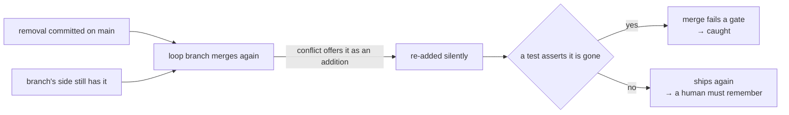

A decision that only exists as a commit ("we no longer compare ROOT's timings with xrdroot's") is undone by the next merge from a long-lived branch, because that branch's side of the conflict still contains the removed code and each merge re-presented it as an addition. This happened twice in a row: round 64's merge re-added `run.add_argument("--previous", type=Path, help="baseline-timings.json to compare ratios with")` to `tools/tutorials/cli.py`, and the removal had to be made again by hand. A grep is a checkpoint, not a guard — put the decision in a test so the next merge fails instead of needing review.

## The grep that finds a re-introduced removal

```bash
grep -rn -E 'root_seconds|baseline-timings|--previous|ratio|ROOT s\b|faster than ROOT' \
    --include='*.py' --include='*.md' --include='*.json' .
```

Run it on the merged tree before pushing, not on the branch: the conflict resolution is where the code comes back. Bare `ratio` is noisy (`re.match`, "compression ratio"), so read the hits rather than counting them.

## Why a test, not a note



An absence is the one kind of decision a diff cannot protect, because nothing in the tree breaks when the old code returns. Assert the absence where it is cheap: `assert "--previous" not in cli.build_parser()._actions_names`, or a test that parses the module's source and asserts the flag is not registered.

## Same shape elsewhere

Anything deliberately removed for good — a fallback, a compatibility shim, a discarded numeric path — returns the same way on the next merge. When you remove something other than dead code, add the assertion in the same commit.
