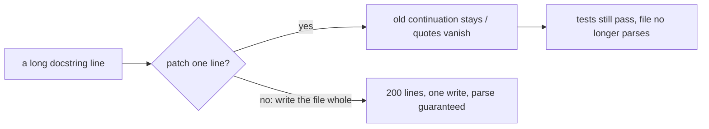

Patching a multi-line docstring by replacing one line at a time silently leaves the old continuation line behind (or deletes the closing `"""`), and the file then fails to parse — after the tests had passed. When a test file needs more than a one-line change inside a docstring, rewrite the whole file with `write`.

## What goes wrong

A docstring is two or three adjacent lines. `lines[46:47] = new_two_lines` keeps the original second line, so the paragraph is duplicated; `lines[46] = 'asked for.'` deletes the `"""` that was on the next line. Neither breaks the *tests*, which still pass — only the next `pytest` run reads the file again:

```text
$ python -m pytest tests/test_formula_select_engine.py
E  File "tests/test_formula_select_engine.py", line 49
E    1 - and the logarithm's way along for ``logc``."""
E  SyntaxError: unterminated string literal
$ ruff check tests   # invalid-syntax: Simple statements must be separated by newlines
```



## What to do instead

Rewrite the file with `write` from the content you already have — for a 150–250-line test file that is one call and it cannot half-apply. Keep it under the 100-column `ruff` limit as you write, rather than fixing `E501` afterwards: five wrap-passes over one file cost more than writing it once.

## The checks that catch it

- `python -m pytest <file>` alone (collection reads the file, so a syntax error shows at once).
- `ruff check src tests tools` prints `invalid-syntax` with the line number.
- `tools/components.py isolate <c> --tests <c>` fails with `Cannot inspect tests/…: unterminated string literal` — the isolation check doubles as a parse check.
