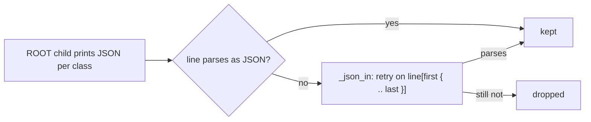

`tools/harvest_infos.py` parses one JSON object per line of a ROOT child's stdout, and a donor whose streamer reading makes ROOT print anything puts a `Info in <…>` line inside the JSON, so the harvest dies with `JSONDecodeError: Expecting value: line 1 column 75`. `TFoam`'s donor is the first that does it; the fix is `_json_in`, which retries on the outermost braces of the line before giving up.

```bash
python -m tools.harvest_infos --root-prefix ~/.local/root-oracle donor.root > infos.json
# before: JSONDecodeError ... column 75      after: 21 classes, TFoam with 40 elements
python -c "import json;d=json.load(open('infos.json'))['classes'];print(len(d),list(d)[:6])"
```



## Why a donor's own output lands in the dump

The child opens the donor with `TFile::Open` and walks `GetStreamerInfoList()`; anything ROOT writes to stdout meanwhile - a banner, an `Info in`, a class that prints while it is read - is interleaved with the JSON on the same stream. So a harvest failure is often **not** a missing class but a parsing casualty, and the class list after the fix is the real one.

## What a TFoam donor gives

| class | elements | note |
|---|---|---|
| `TFoam` | 40 | includes `fAlpha[fDim]`, `TFoamCell** fCells` with `fNCells` entries and `std::vector<Long_t> fCellsAct` |
| `TFoamCell` | 16 | the cells themselves, each a streamed object |

Harvesting the layout is therefore done and cheap; writing a `TFoam` that ROOT reads with the same values is not, because `tools/tutorials/compare.py` compares ROOT files **key by key and value by value**, and a sampler that does not reproduce FOAM's cell grid produces different values. Expect `UNSUPPORTED → DIFF` from a partial persistency, never PASS.
