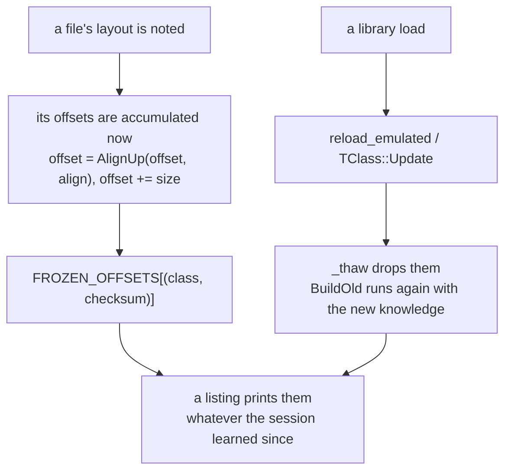

A member's `offset=` in a streamer-info listing is the offset `TStreamerInfo::BuildOld` accumulated **when the file was read**, not the one the session's knowledge would give it later: a dictionary or an `#include` arriving afterwards does not move it, and computing the offsets when the layout is printed answers with today's knowledge and disagrees with ROOT.

`roottest/root/io/stdpair` says it twice, with the same two input files. The `2_*_1_*` families read `aa02.root`/`ab02.root` **before** `#include "cmspair.h"` and print `second offset= 8` - the emulated guess for a class nothing describes yet - while the `2_*_0_*` families read the same files **after** the include and print `4`, which is `edm::Ref`'s own alignment (`edm::RefCoreWithIndex` is `ushort, ushort, unsigned int`). A printer that asks `_has_dictionary` at print time answers 4 in both and keeps four tests DIFF.

The other half is that a **library load re-emulates** the class: `TClass::Update` (through `R__ForceReload` in the collection proxy) runs `BuildOld` a second time, and that run does know the classes the load just described - which is why `0_*_1_1`/`1_*_1_1`, read before the load, print 4 and not 8. So the rule is *frozen at the read, thawed by a load*, and nothing else thaws it.

## What to do

Keep the offsets beside the layout's checksum where the file is noted (`FROZEN_OFFSETS` in `src/xrdroot/pyroot/core/reflection.py`, filled in `note_file_infos`), print them for a layout that came from a file of a class nothing in memory describes, and drop them in `reload_emulated` - a load is the one event that lays a class out again.

`tests/test_pyroot_reflection.py` pins the three cases: read with the class unknown (`[0, 8]`), read with it known (`[0, 4]`), and read before a `reload_emulated()` (`[0, 8]` then `[0, 4]`).

This does **not** decide which layout is a class's *current* one: that is `W0-245`, and it is why `io/stdpair` still has 20 DIFFs after this rule landed - the `0_*_*_0`/`1_*_*_0` families list ROOT's current layout (the **emulated** spelling, `first type=13`) where this kit lists the file's mapped one.
