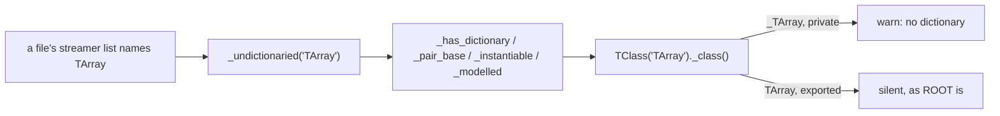

Two ROOT classes were missing from the namespace in ways only a *file* reveals: the arrays' abstract base `TArray`, and `TString` as an argument where ROOT's C++ layer takes a `const char*`. Both made this kit print or refuse something ROOT does not.

## `TArray` is a class, and a file that describes one gets no warning

A ROOT file's streamer list names `TArray` when it holds one of the fixed arrays. `pyroot/core/reflection.py::_undictionaried` decides whether to print ROOT's `Warning in <TClass::Init>: no dictionary for class TArray is available` — it ends with `TClass(name)._class() is None`, the namespace's own answer. The array family lived under a **private** `_TArray` base, so the namespace answered no and the warning appeared in every test whose file mentioned it: `io/evolution/ClonesArrayEvo`, `io/fakeClass/forwardDeclAndFake` and `treeformula/formulaio/old-formula` each differed from their ref by that one line.

Renaming the base to `TArray` and exporting it is the whole fix: `TArrayD` and its kin now really derive from ROOT's abstract base, `TClass("TArray")._class()` answers, and the warning is silent exactly where ROOT's is. It is the same rule round 119 recorded for a *declared* class and round 122 for a class with its own dictionary: **the namespace's answer decides, not a list of names**.



## `TString` where ROOT takes `const char*`

`roottest/root/tree/cache/runmultiTree.C` writes ROOT's own idiom:

```cpp
TString lname = Form("%s_i_%d", tree->GetName(), i);
tree->Branch(lname, &var[i], lname, 512);
```

The C++ layer converts a `TString` to `const char*` implicitly, so the branch name and the leaf list are both its characters. This kit's writer takes a `str` and refused (`ValueError: the column name must be a str, not TString`). The conversion belongs in the `pyroot` wrapper and not in the engine — `pyroot/trees/tree.py::_text` answers a `TString`'s characters at `TTree::Branch` and leaves anything else for the layer that refuses it to name. A component boundary decides where a convenience lives.

## What it cost, and what it did not buy

Three tests went DIFF → PASS and none was lost. `tree/cache/multiTree` and `tree/friend/UnevenChain` moved from FAIL to a refusal at `TTreeCache`, which is cache bookkeeping the refs pin in detail; `io/webfile/CloseTWebFile` still warns of `TGeoPatternFinder`, geometry this kit does not model. Both are `TODO.md` rows.
