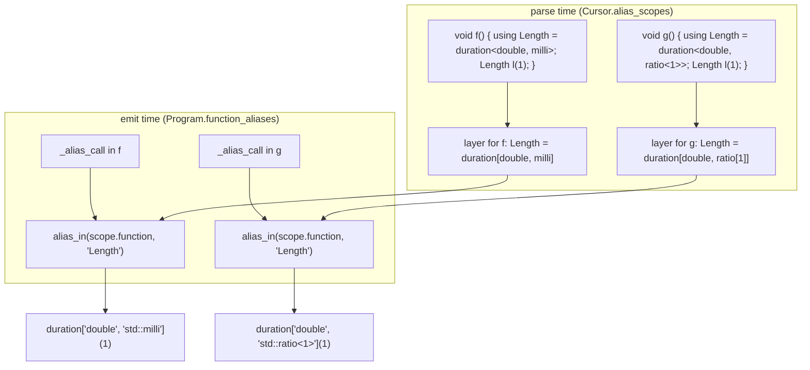

A `using` written inside a function lasts only to the end of that function, so the translator needs one alias table per function: two functions in one program may give one name two different types, and ROOT's own `roottest/root/io/cpp11Containers/commonUtils.h` does exactly that.

## What broke

`commonUtils.h` writes, in one function template,

```cpp
using contPair_t = std::pair<typename NestedCont::key_type, typename NestedCont::mapped_type>;
```

and eighty lines later, in another,

```cpp
using contPair_t = std::pair<typename Cont::key_type, typename Cont::mapped_type>;
```

The translator kept **one** alias table for a program's functions — `Program.local_aliases` — because what asks for an alias is a *call* (`cv_milli_t(end - start)`) emitted with no view of the block it stands in, and it refused the second definition: `the name contPair_t stands for two types in one program`. That refusal blocked all six `roottest/root/io/cpp11Containers/*` tests and two `roottest/root/math/smatrix/*` ones, whose `testOperations.cxx` gives `MnMatrix` three meanings in three functions.

## The shape that works

Two tables, one for each question:

- **A type position** is answered while the declaration is read: `parse_types._alias` replaces an alias with the `CType` it stands for and the node keeps it forever. So `Cursor.alias_scopes` is a **stack** laid on `variables` — `push()`/`pop()` open and close a layer, `alias_of(name)` asks the innermost first — and the parser's `alias()` writes into the layer it is standing in.
- **A value position**, the call `X(...)`, is answered at emit time, so `Program.function_aliases[id(func)]` keeps each function's own and `Program.alias_in(self.scope.function, name)` is what `emit_calls._alias_call` asks. Names a program's functions agree on also stay in `local_aliases`, for a call emitted with no function in scope.

The refusal survives for the one case C++ also rejects: **one body** giving one name two types.



## What it cost and what it gained

`io/cpp11Containers` went from 1 PASS / 6 UNSUPPORTED to **3 PASS / 4 UNSUPPORTED** — `unorderedMap-libgen-build` and `unorderedSet-libgen-build` are two baseline promises restored. The four runtime tests moved to a different wall, a **template template parameter** (`template <template <typename T, typename V = allocator<T>> class Cont>`, then `Cont<double>` in the body), which the translator still emits as `ROOT.Cont['double']` — `W0-252` in `TODO.md`.

The `smatrix` pair moved from a refusal to their next walls (`SMatrix['double', 'NDIM1', 'NDIM2']`, `ROOT has Add`), and one test that had covered `_type_scope`'s unnameable-template guard stopped reaching it — a function-local `TypeParam` no longer leaks into the generated GoogleTest class — so `tests/test_cint_grammar.py` now pins that guard itself.

## Where it lives

| Question | Code | Table |
|---|---|---|
| What type is `contPair_t` here? | `pycxx/cursor.py::alias_of`, `pycxx/parse_types.py::_alias` | `Cursor.alias_scopes` |
| What does `X(...)` make here? | `pycxx/emit_calls.py::_alias_call` | `Program.function_aliases`, then `local_aliases` |
| Who fills both | `pycxx/parse_stmt.py::alias`, `pycxx/program.py::_local_alias` | — |

`tests/test_cint_typedefs.py` pins the three rules: each function gets its own type, an alias does not outlive its function, and one body still refuses a second type of the same name.
