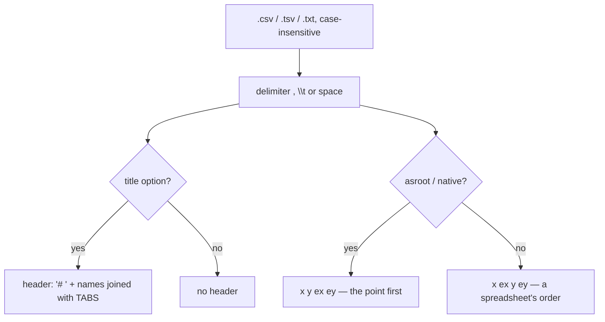

`TGraph::SaveAs` writes a `.csv`, a `.tsv` or a `.txt` — a comma, a tab or a space between the
values — and `TGraph(filename, format)` reads one back. Ten files this kit writes are byte for
byte what the 6.40 oracle writes (round 81, `cmp` on every one), and these are the four rules
that make them what they are. Each looks like a bug until it is written down.

## The header is written with tabs whatever the delimiter is

`title` writes one line, `"# "` and then a name per column, joined with **tabs** — even into a
`.csv`, whose values are commas. That is what ROOT does, because every spreadsheet that reads
these files has been handed a tab-separated header, and it is why a `.csv` of a graph has a
first line you cannot parse with the file's own delimiter.

The point's own two columns hold the **axes' titles** in place of `x` and `y`; the bars keep
their own names (`ex`, `ey`, `exl` …). A graph saved with `title` and no axes' titles therefore
starts `"# \t"` — the header line is there, naming two empty columns.

## A point comes before its bars only when asked

`asroot`/`native` writes `x, y, ex, ey`; the default is a spreadsheet's `x, ex, y, ey`, so each
point's own errors sit right after it. An asymmetric graph has six columns either way
(`x, y, exl, exh, eyl, eyh` or `x, exl, exh, y, eyl, eyh`), and a graph keeping no bars has two.

## A number is `ostream`'s `%g`

Six significant digits and no `.0` after a whole one: `3`, not `3.0`; `0.000123457`, not
`0.00012345678`. A file written with Python's `repr` of a float differs on every whole number.

## Reading one back has four rules of its own

- **A line of fewer than two numbers is skipped**, not an error: a comment, a header, a line
  holding a word. That is how ROOT's own reader survives a file it wrote with `title`.
- **A column a line does not have is left at zero** — a short line is not a refusal.
- **The scan of a line stops at the first word**: `1,nope,3` is a line of one number, and so a
  skipped line; nothing after the word is read.
- **A file that cannot be opened is `None`**, which the caller answers with a graph of no points
  and ROOT's `Error` line — not a refusal. A file of nothing but comments is columns of no values.

The rules live in `xrdroot/graph.py`: `TEXT_DELIMITERS` and `TEXT_ORDERS` are the two tables,
`text_lines` writes one, and `read_text` reads one; `tests/test_graph_text_engine.py` pins every
rule above in a second, without the harness.
