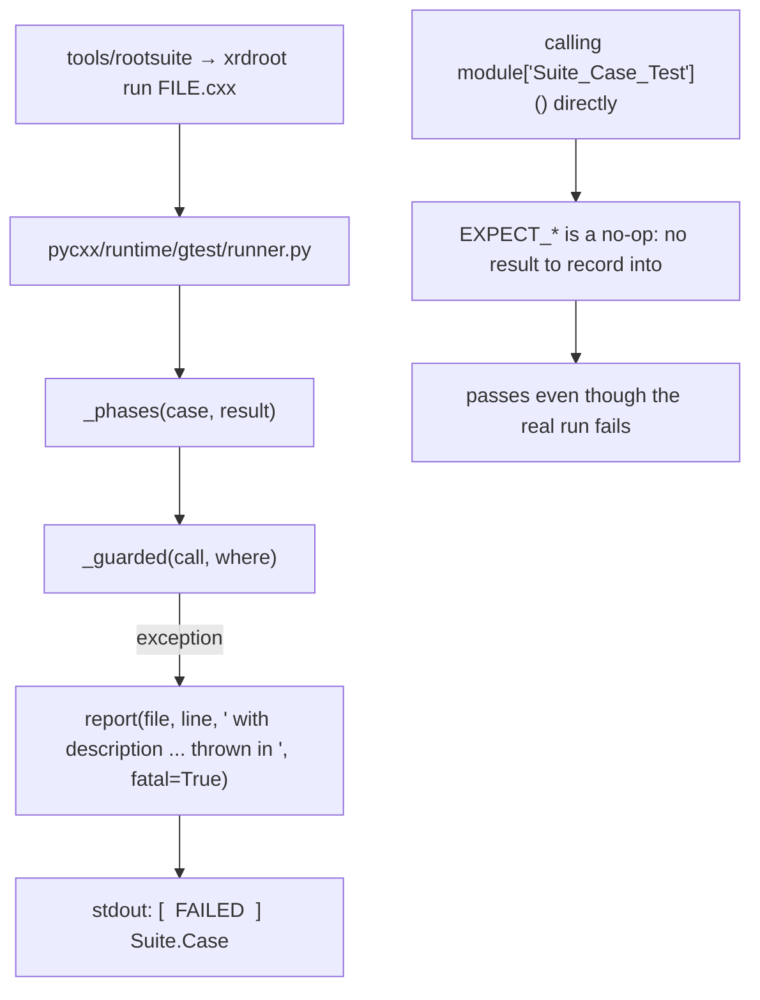

A gtest program's failing case is not where the failure appears to be: `xrdroot run testKahan.cxx` reported `TypeError with description "unsupported operand type(s) for -: 'int' and '_VectorIterator'" thrown in the test body` for 10 cases whose bodies **pass when called directly**, because `EXPECT_*` outside the gtest registry is a no-op and the exception is raised inside a comparison. Diagnosing a gtest failure therefore means running the *runner*, not the test function.

## The path a case takes



`_guarded` (`src/xrdroot/pycxx/runtime/gtest/runner.py`) is the seam: it catches the exception, asks `REGISTRY.locate(why)` for a file and line, and reports it as a fatal failure of that case. The message names `where` — "the test body", "SetUp()", "TearDown()", "the test fixture's constructor" — which is how to tell a fixture failure from a body one.

## How to see the traceback

The runner swallows the stack; patch `_guarded` before the file runs and re-raise loudly:

```python
from xrdroot.pycxx.runtime.gtest import runner
import traceback
def loud(call, where):
    try:
        return call()
    except Exception:
        print("=== in", where); print("\n".join(traceback.format_exc().splitlines()[-12:])); raise
runner._guarded = loud
```

then translate and run the file in the same process (`xrdroot.cint.translate`, `exec` the code, call `main()` — or import the app's runner module it uses). `tools/rootsuite`'s per-test log at `RUN_DIR/logs/gtest/<path>/run.log` keeps only what the runner printed, so it never holds a stack.

## What this dispelled

The three `KahanTest.*` cases in `testKahan.cxx` do run (assertions and all) and their failure is a different suite's: the 10 failing cases are `KahanAddSubtractAssignTest.*`, which use `sum += other` / `sum -= other` on `ROOT::Math::KahanSum`. `ROOT.Math.KahanSum` (added at `e7b52186`, `src/xrdroot/pyroot/core/kahan.py`) removed the `has no attribute KahanSum` cases but did not touch this one.

Also worth knowing: a plain `exec` of a translated gtest file finishes silently — the cases live in `REGISTRY` and only `main()` runs them.
