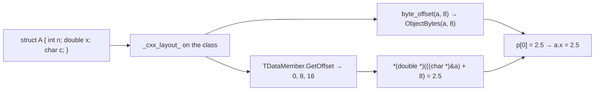

A macro that fills a class through `TDataMember` writes into the object **by byte offset** — `*(int *)(((char *)obj) + member->GetOffset()) = value` — so the offset must be the Itanium ABI's, the same rule `pycxx/sizes.py` uses for `sizeof`, and `(char *)obj + off` must name the member that starts there.

## The three pieces

- **`TDataMember::GetOffset()`** answers where the member starts: each member at the next offset its alignment allows, a pointer taking eight bytes. It reads the members the translator wrote on the class (`_cxx_layout_`), through `TClass._cxx_fields()`. A class this kit does not work out — an **array** member, a member that is **another class**, or a class **no macro declared** — answers 0, as it always did; a wrong number is worse than none.
- **`TDataMember::GetDataType()`** answers the `TDataType` a named type is (`int` 3, `double` 8, `char` 1, from `wclasses.TYPES`) and **`None`** for a class or a pointer — ROOT does not call a pointer basic either, so `int *p` has no data type.
- **`cppstd.cells.byte_offset(obj, off)`** gives an `ObjectBytes` for an offset a member starts at: `p[0]` reads it, `p[0] = v` writes it, every other name forwards to the object (`(T *)((char *)obj + 0)` cast back *is* the object), and an offset of 0 that starts no member stays the object — the base class at the object's start, whose `TClass::GetBaseClassOffset` is 0.

## What it does not yet buy

`roottest/root/io/datamodelevolution`'s `Generator.h` gets past `GetDataType` (line 242) and `(char *)` of a `void *` (line 223, which `emit_expr._an_address` now follows), then stops at **line 247**: `((char *)obj) + member->GetOffset()` is emitted as a plain `+` because the `void *` parameter's declared type is not known where the operand is emitted, so the offset meets the object as a `str`. The fix belongs in the emitter's binary handler — a `+` whose left side is an object-bytes expression must go through `byte_offset` — and that is what the next round should take.

## Where it lives

`pyroot/core/reflection.py` (`TDataMember.GetOffset`/`GetDataType`, `_member_offsets`, `TClass._cxx_fields`), `cppstd/cells.py` (`byte_offset`, `ObjectBytes`, `_SIZES`, `_member_offsets`), `pycxx/emit_expr.py` (`_an_address`). Tests: `tests/test_pyroot_reflection.py` (offsets 0/8/16/24, the data types, and the 0 for what is not worked out) and `tests/test_cint_expressions.py` (the write through bytes, the refusals, and the emitted shape).
