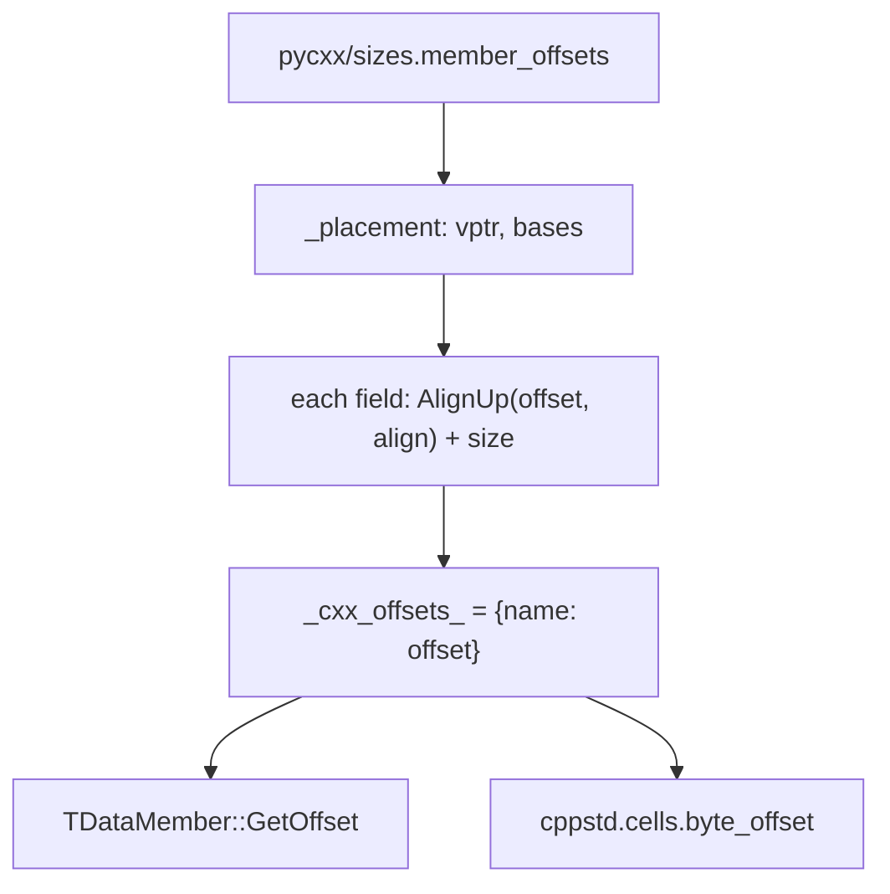

`TDataMember::GetOffset` and `cppstd.cells.byte_offset` must read the **same** map of member offsets, and that map must come from the translation of the class — otherwise a macro is told one offset and writes at another.

## What the two tables did

`reflection._member_offsets` walked the class's own members with `wclasses.TYPES`; `cells._member_offsets` walked `_cxx_layout_` with `_SIZES`. Neither included the bases or the virtual table's pointer, and both bailed to "no layout" on any array member. So for roottest's `ClassA` the dictionary said `m_c` is at 24 while `byte_offset` answered `[0, 8, 24]`, and `(char *)obj + 24` raised `TypeError: 'ClassA' object does not support item assignment`.

## The shape that works

`pycxx/sizes.member_offsets(info, program)` is the one walk: `_placement` puts the virtual table's pointer and the bases, then each field at the next offset its alignment allows (a union's all at 0), and each **base's members are folded in** at the offsets they sit at. The emitter writes it on the class as `_cxx_offsets_`; both readers return `dict(found)`.



Base members are not a nicety: `Generator.h` recurses with `((char *)obj) + cl->GetBaseClassOffset(baseCl)` and the **base's** `TClass`, while the object stays the derived one — a map of the class's own members alone can never answer the offset it asks for.

## Take the numbers from the oracle, not from yourself

An interpreted class answers `GetOffset()` with no ACLiC at all:

```bash
~/.local/root-oracle/bin/root -l -b -q probe.C     # no '+' — cling's own AST gives the layout
```

ROOT 6.40.04 on `struct Plain { bool b; char c; short s; int i; long l; long long ll; … int arr[3];
int n; double *var; //[n] … }` answers 0,1,2,4,8,16,24,28,32,40,48,56,64,68,72,84,**88**,96,104,128,
152,176,200,224,240,264; `UnableProbe { int n[3]; TObject *o; TString text; }` answers **0/16/24** —
an array member does get an offset (`Plain::arr` is 72), and `n` is 0 only because it starts there.

Two existing tests asserted 0 where ROOT says 16 and 88. They were **corrected against the oracle's
output**, quoted in their docstrings — never against whatever the new code happened to answer.

## Two traps in the guard

- A class that reaches itself — `class A : public A`, `struct Self { Self inner; }` — needs the
  re-entrance refused **where a layout is entered** (`_extent`), not in the nested helper: guarding
  `_placement` broke `sizeof` of every class with a base, because `_class → _extent → _placement`
  is a legitimate nest for the *same* class.
- `_polymorphic` re-enters itself through `_polymorphic_base` and never passes `_extent`, so it
  needs its own `seen` lineage.
