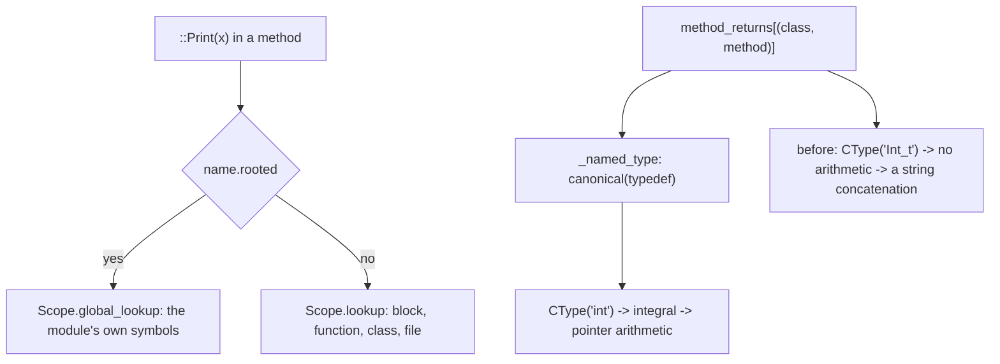

Two translator bugs of the same family, both found by roottest's `datamodelevolution` generator and both about what
a *name* means:

1. **`::Print(x)` inside a class's method is not the class's member.** `Scope.lookup` walks block, function, class,
   then file, which is right for a bare `Print(x)` (C++ finds the member) and wrong for `::Print(x)` - a leading
   `::` names the global namespace. The kit emitted `self.Print(self.fSingle)`, so `Holder::Print` called itself and
   died `Holder.Print() takes 1 positional argument but 2 were given`. `Scope.global_lookup` answers from the
   module's own scope.
2. **A `method_returns` entry is a declaration.** `infer._named_type` built a `CType` from the table's text
   verbatim, and `CType("Int_t").integral` is false - `INTEGRAL` holds C's canonical names only - so
   `((char *)obj) + cl->GetBaseClassOffset(base)` was not pointer arithmetic and fell through to the
   string-concatenation rule, emitting `obj + cstr(cl.GetBaseClassOffset(base))`. `_named_type` canonicalises the
   name through the typedefs (`canonical`), so an entry naming `Int_t` is the `int` every arithmetic rule here is
   written against.

## What the next wall in that family is

The generator writes member values through raw pointers - `*(int *)(((char *)obj) + member->GetOffset()) = genInt()`
- and `cppstd.cells.byte_offset` refuses any offset but 0 by design ("only an offset of 0 - a base at the object's
start - is followed"), so it wants the member whose recorded `fOffset` is that offset. And `Overloaded.__call__`
matches candidates on Python *kinds* and silently calls its first when none match: a `std::vector<T>` is a
`_Vector`, not a `list`, so `Print(const std::vector<Values>&)` never matched and `Print(const Values&)` ran.
Both are queued (`W0-233`, `W0-238`).
