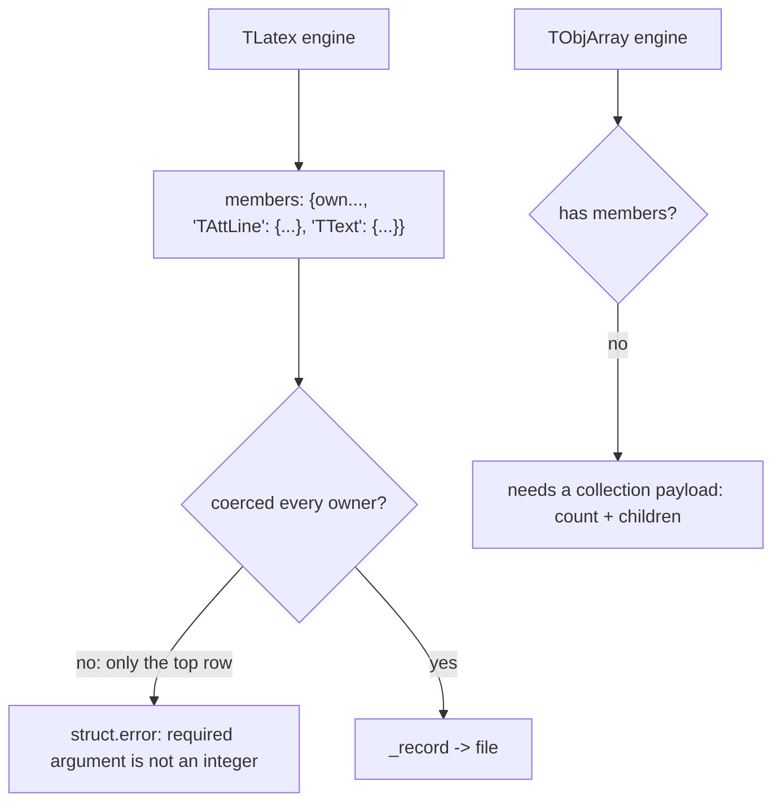

`TLatex`'s members reach the packer with the wrong Python types for two different reasons, and only the first is fixed by casting the top-level row: **base classes keep their members in nested dicts** (`{"TAttLine": {"fLineColor": 1.0}}`), so a coercion that walks only `layout_of("TLatex")` leaves the bases' numbers untouched and `struct.pack` raises `required argument is not an integer`. `TObjArray` is further away again: its engine has **no `members` at all**.

```python
# what the engine of a TLatex hands over
unwrap(ROOT.TLatex(0.1, 0.2, "hi")).classname   # 'TLatex'
unwrap(ROOT.TLatex(0.1, 0.2, "hi")).members     # dict, with nested base dicts
unwrap(ROOT.TObjArray()).members                # AttributeError: no members
```

## What a fix has to do

1. Coerce **every** class in the description closure, not just the class being written: walk `_closure({"TLatex": None})` and cast each owner's row — the class's own at the top, a base's inside its nested dict.
2. Cast by what the element declares, not by what Python holds: `FORMS[stype] in "bBhHiIlLqQ"` means `int`, anything else `float`. The engine keeps some integer flags as floats, which is why the plain `_object_payload` path fails where `TGraph2D` succeeded.
3. `TObjArray` needs a real collection payload — a count plus each child written through `_record` — because the engine carries no members to normalise.



## Why this is worth recording

The pattern "cast numpy scalars to int/float" worked for `TGraph2D` and is *not enough* one class later — the difference is that `TGraph2D`'s row is flat and `TLatex`'s is nested by base. Anyone repeating the `TGraph2D` recipe on a class with bases will hit this, and the error message points at the packer rather than at the nesting.
