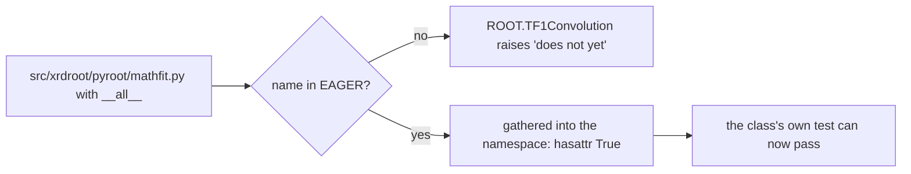

Adding `TLinearFitter`, `TMinuit`/`gMinuit` and `TF1Convolution` needed a home that is in the namespace from the start, and the trap is that a new module is only reachable if its name is in `EAGER` in `src/xrdroot/pyroot/__init__.py` — the module's own `__all__` is not enough, and `ROOT.TF1Convolution` keeps saying "does not yet" until that one line exists.

```bash
# the module: src/xrdroot/pyroot/mathfit.py
# the line that makes it reachable: EAGER in src/xrdroot/pyroot/__init__.py
PYTHONPATH=$PWD/src python -c "import xrdroot.pyroot as R; print(hasattr(R,'TF1Convolution'), hasattr(R,'gMinuit'))"
PYTHONPATH=$PWD/src pytest -q tests/test_writer_tarray.py
ruff check src/xrdroot/pyroot/mathfit.py
```



## What went in, and the three bugs running found

| class | the part worth knowing |
|---|---|
| `TLinearFitter` | terms come from the formula split on `++`; `Fit` is `np.linalg.lstsq` on a design matrix, so `"1++x"` over `y = 2 + 3x` returns exactly `[2.0, 3.0]` with `chi2 = 0.0` |
| `TMinuit` / `gMinuit` | ROOT's `FCN` is `fcn(npar, gin, f, par, iflag)` and writes the value through `f`; `Migrad` here is a shrinking simplex, enough for a smooth one-dimensional cost |
| `TF1Convolution` | `Eval(x)` integrates `f1(t) * f2(x - t)` on a fixed grid over `GetRange()` |

Three things failed on first run: `groups=("graph",)` is not a group (`drawn.GROUPS` has `line`, `fill`, `marker`), `TLine` lives in `pyroot/graphics/shapes.py` not `line.py`, and **`np.trapezoid` does not exist in this NumPy** — use `np.trapz`.

## Why the check is `hasattr`, not the test

A class can pass its own test while the tutorials still refuse it, because the refusal comes from the namespace. `python -c "print(hasattr(R,'gMinuit'))"` is the one-line check that a tutorial's `gMinuit->Migrad()` will resolve at all.
