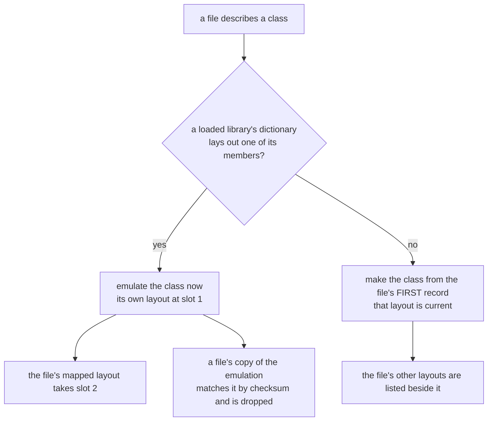

Whether a class's *emulated* layout or a file's first record becomes the class's current streamer info depends on what the session knew **before** the file was read: with a loaded library's dictionary for the class's members ROOT emulates the class and registers that layout first, and with nothing at all it makes the class *from* the file's first record - and the difference is two `#N` blocks and which layout is printed as current.

`roottest/root/io/stdpair` states it four ways, with the same two input files. A **library** whose header dictionaries `edm::Ref` and not the pair (`libCmsPairCollection`, `libCmsPair`'s ACLiC twin) prints the emulated layout as current - `checksum=0xb5fb752`, `type=13 Emulation`, action `13` with no `newtype` - in **either** file order, and the file's mapped layout beside it as `#2`. `kNothing` and the interpreted `#include "cmspair.h"` print the **first record a file holds**: with `ab02.root` first that is the mapped layout, so the emulated one appears twice below it.

The tell for the emulation is the element **title**: `R__CreateEmulatedElement` titles what it builds `Emulation`, which is the one title `pairEnumEvo`'s own `printElements` keeps and clears from every other element. And what counts as "a library's dictionary" is a loaded library's LinkDef selection, not an interpreter declaration: this kit's `GENERATED` names the classes a load declared (`Ref`, not `edm::Ref<...>`), while an `#include` leaves it empty - which is exactly the split the refs show.

## The state is the one the file was read in, not the one it is printed in

A session that learns the class **after** the file was read does not get the emulated layout as its
current one: ``io/stdpair``'s ``2_*_1_*`` families read their files before ``#include "cmspair.h"``
and keep the first record's layout, while the ``2_*_0_*`` families - the same include, the files read
after it - get the declaration's. And an ``#include`` is a **declaration**, not a dictionary: the
class is laid out from it, so its own layout is the file's *mapped* spelling, where a loaded
library's dictionary makes ROOT *emulate* the class and its own layout the emulated one. That is why
the answer has to be recorded once, as the first layout is noted (``DESCRIBED`` in
``src/xrdroot/pyroot/core/reflection.py``), with three values - ``"dictionary"``, ``"declaration"``
and ``None`` - rather than asked at print time.

## What to do

Ask two questions of the session, not of the file: has a **loaded library** a dictionary of the class (`GENERATED`), and one of a member's type. Only where the answer to the second is yes and to the first no is the emulation the class's own layout - and it is listed at the class's **own** version (the version the first record gave it), not at the version the copy the file happened to hold named.

`src/xrdroot/pyroot/core/reflection.py`'s `_file_layout` is that decision, with `_emulated_spelling` and `_could_be_emulated`/`_dictionaried` beside it; `tests/test_pyroot_reflection.py` pins both answers (`test_a_pair_a_library_s_dictionary_reaches_is_emulated_before_its_files`, `test_a_pair_nothing_describes_is_laid_out_from_the_first_record_a_file_holds`).

What is left of `io/stdpair`'s 16 DIFFs is not this rule: `0_*_1_0`/`1_*_1_0` keep four blocks (a re-emulated class whose *files* were read first), `2_*_0_*` want `TStreamerInfo::Build`'s per-member warning, and the eight `3_*` families are the pair's own dictionary, where the mapped layout is current (`W0-248`).
