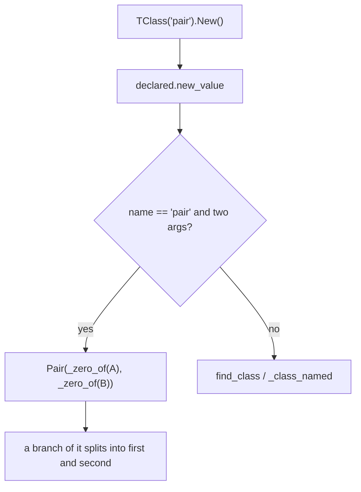

A `std::pair` has no class entry in this kit's reflection table, so two things that look unrelated both fail on one: a branch given a pair address with no leaf list cannot say its type, and `TClass("pair<A,B>").New()` answers `None`, which leaves the generator's pointer null and the branch untypeable anyway.

## The branch: a pair is two members

`roottest/root/io/datamodelevolution/01/test1.cxx` writes

```cpp
pair<int, double> *pr = 0;
tree->Branch( "TestPair", &pr );          // no leaf list at all
```

`pyroot/trees/tree.py::_leaf_branch` asks `_declared(address)` for a leaf, and a pair address says nothing — `address.dtype` is `None` and the refusal is *"was given no leaf list, and what its address holds does not say its type"*. ROOT splits a pair into its two members, so the branch is two leaves named **`first`** and **`second`**, each with the code its member's type has:

```python
elif _a_pair(address):                    # isinstance(getattr(address, "value", address), Pair)
    pair = getattr(address, "value", address)
    leaves = [_pair_leaf(name, pair, "first"), _pair_leaf(name, pair, "second")]
    addresses = [Member(pair, "first"), Member(pair, "second")]
```

`Member(holder, name)` already existed for a multi-leaf branch over an object's members, so the pair path is the multi-leaf path with two addresses — nothing new in the store.

## `New()`: a default pair is a zero of each

`TClass("pair<int,double>").New()` went through `_class_named` and answered **`None`**, so `new pair<A,B>()` gave `None` and the generator's `pr` stayed null. `declared.new_value` now answers a `Pair` of a zero of each member:

| member's type | zero |
|---|---|
| `int`, `double`, `float`, `long`, `short` | `0` / `0.0` |
| `char` | `"\x00"` |
| `bool` | `False` |
| `std::string`, `string`, `TString` | `""` |
| `pair<A,B>` | a pair of its own zeros |
| anything else | `None` |



## How to check it

```bash
export PYTHONPATH=$PWD/src
.venv/bin/python -m pytest -q tests/test_pyroot_trees_write.py -k pair_splits
.venv/bin/python -m pytest -q tests/test_pyroot_reflection.py -k default_made_pair
```

The second covers the zeros, a nested pair included; the first pins the two leaves and their titles. Note what the title **is**: this writer spells an `int32` leaf `i` where ROOT spells its `Int_t` `I` — a property of the writer's whole leaf table, not of the pair, and `W0-270` in `TODO.md`.
