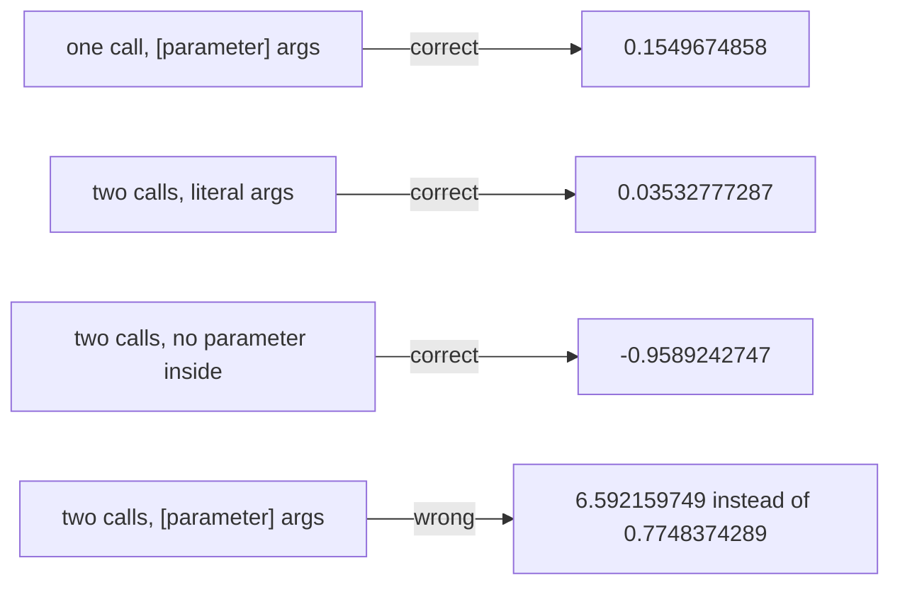

An expression that calls the same function twice with `[parameter]` arguments in one `TF1` formula evaluates wrongly: the second call reuses the first call's parameter slots. Calls with literal arguments, and calls with no parameters inside them, are both right - so the bug only shows when a parameterised density appears twice in one sum.

## The measurement

On the ROOT 6.40 oracle and here, at x = 5, with the parameters named:

```text
[a]*TMath::Gaus(x,[m],[s])                  ours 0.1549674858   ROOT same
[a]*TMath::Gaus(x,[m],[s])
  + [b]*TMath::Gaus(x,[m],[s]) (0.2,.8,10,7)  ours 6.592159749   ROOT 0.7748374289   <- wrong
[a]*normal_pdf(x,1,10)+[b]*normal_pdf(x,7,10) ours 0.03532777287  ROOT same
[a]*sin(x)+[b]*sin(x)                       ours -0.9589242747  ROOT same
```



ROOT's answer for the failing row is the plain `exp(-0.5((x-m)/s)^2)` with the weights summing to one, i.e. what the formula means.

## Why it matters beyond one test

`gtest/hist/hist/testTKDE` fills its comparison histogram from a two-Gaussian mixture written exactly that way, so nine of its twelve cases failed for this and not for the kernel density estimate they test - the estimate agrees with ROOT to 1e-16. Any `TF1` a macro builds as a sum of two parameterised densities, and `TTree::Draw` expressions of the same shape, are wrong the same way.

## Where to look

`formula/parser.py`'s call node and the parameter binding it emits: compile `[a]*TMath::Gaus(x,[m],[s])+[b]*TMath::Gaus(x,[p],[q])` with four distinct parameters and see which value each call receives.
