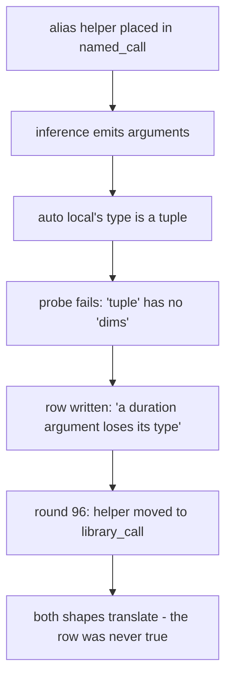

A queue row is only as good as the tree it was measured on. `W0-218` said a `std::chrono` duration *argument* to a function's `using` alias loses its type — and it was false: both `cv_milli_t(ms)` and `cv_milli_t(end - start)` translate and run at round 96's base. The probe that named it was taken while round 95's **own first shape** of `_alias_call` sat inside `named_call`, where it emitted arguments during inference and turned every `auto x = f()` into a `tuple`. The bug was the round's intermediate state, not ROOT's behaviour and not the kit's.

## What to do

1. **Measure a row against a *committed* tree**, not the tree you are halfway through. If the round's own edit is in flight, either stash it or copy `src` and measure the copy.
2. Before closing a round, re-run its own failing probe on the final tree. A row whose probe now passes is either closed by the fix (good) or was never true (say which).
3. The same caution applies to a *harness* measurement taken mid-round (`W0-56`, `W0-63`): a refusal that moved is not a refusal that was fixed.

## The other half of round 96

`TGraph::Eval` on a graph `Sort` put in x order read no bit here at all — the engine re-derived sortedness with `np.all(np.diff(xs) > 0)` on every call. On 200 000 descending points that is **18 467 µs a call before `Sort` and 208 µs after** it, the same answer either way (`24691.0`): ROOT's `kIsSortedX` exists precisely to save that, and `graphmath.evaluate(..., sorted_x=...)` is where it now lands.
