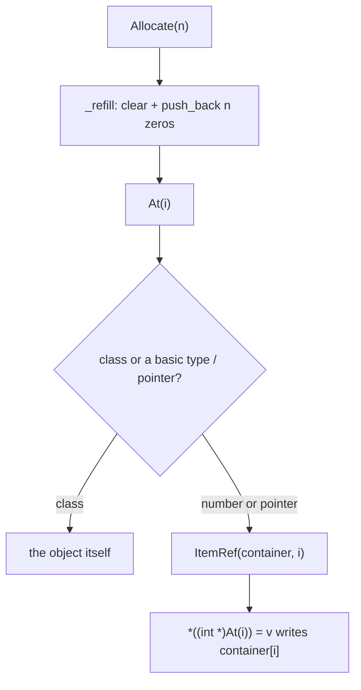

A `TVirtualCollectionProxy` in this kit answers `At(i)` with the **value** a reader wants, while ROOT answers a `void *` a writer writes through — so `*((int *)proxy->At(i)) = v` has nothing to land in, and changing `At` outright fails two tests that pin the value.

## The four defects one fill uncovers

`roottest/root/io/datamodelevolution/common/Generator.h` fills a base-type collection with

```cpp
TVirtualCollectionProxy::TPushPop helper( proxy, obj );
proxy->Allocate( genInt(), false );
for( UInt_t i = 0; i < proxy->Size(); ++i )
   *((int *)proxy->At(i)) = genInt();
```

Measured one at a time, each is a real defect:

| defect | what it did | the shape that fixes it |
|---|---|---|
| `Allocate` filled nothing | it required `isinstance(held, list)`, and the guard pushes the macro's own `vector<int>` | `_refill(held, made)`: a list takes the slice, a C++ container is `clear()`ed and `push_back`ed |
| `At` answers a value | `*((int *)At(i))` is `4[0] = v` | `ItemRef(container, index)` for a basic type's **or a pointer's** slot; the object itself for a class |
| a `pair` had a collection proxy | `TClass("pair<int,double>").GetCollectionProxy()` built one, so the generator filled a pair element by element | `COLLECTIONS` in `pyroot/core/reflection.py`: `pair`, `array` and `bitset` are containers of a kind and not *collections* — ROOT answers null |
| `ObjectAddress` was not stepped | `char_pointer(rcl.New())` handed on, then `byte_offset(addr, 8)` refused | `byte_offset` unwraps an `ObjectAddress` to the object it holds |

Together they took `io/datamodelevolution` from **22 PASS / 20 FAIL / 2 DIFF** to **22 / 14 / 2 / 6**,
the six children of `01/test1` becoming its fixture dependants, and walked the whole base-type fill.



## Why it was reverted, and what the next attempt needs

Two tests pin `At`'s **value**: `(1, ItemRef({ 4 }, 0)) != (1, 4)` and
`(3, ItemRef(<map<int,double> {1: 2.0}>, 0)) != (3, (1, 2.0))`. ROOT's own
`TVirtualCollectionProxy::At` was **not** measured against the oracle before the change, so the tests
stand and the shape is the next attempt's specification: **`At` must serve a reader its value and a
writer an address** — an `ItemRef` that compares equal to its value, or a second accessor, chosen by
measuring ROOT first:

```cpp
// probe: what does ROOT's At answer, and can a program write through it?
TVirtualCollectionProxy *p = TClass::GetClass("vector<int>")->GetCollectionProxy();
p->PushProxy(&v); p->Allocate(2, false);
*((int *)p->At(1)) = 42;  printf("%d\n", v[1]);
```

## How to check the pieces that are independent

```bash
export PYTHONPATH=$PWD/src
.venv/bin/python -m pytest -q tests/test_pyroot_collections.py tests/test_pyroot_reflection.py
```

`GetCollectionProxy`'s null for a `pair`/`array`/`bitset` and the `ObjectAddress` unwrapping are not
what the two tests object to; they can land on their own.
