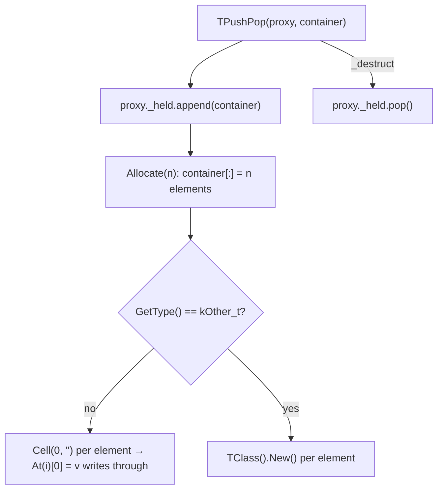

A `TVirtualCollectionProxy` in this kit is a *view* over a container, and a program that fills a collection of a basic type writes through the address `At(i)` gives — so the elements must be cells, the proxy must be pointed at the container by a guard, and `New()` is the container, not the element.

## What a program does

`roottest/root/io/datamodelevolution/common/Generator.h` fills a `std::vector<int>` (and every other base-type collection) inside ROOT's own RAII guard:

```cpp
TVirtualCollectionProxy::TPushPop helper( proxy, obj );
proxy->Allocate( genInt(), false );
for( UInt_t i = 0; i < proxy->Size(); ++i )
   *((int *)proxy->At(i)) = genInt();
```

## The three pieces, in `src/xrdroot/pyroot/core/collectionproxy.py`

| piece | what it must do |
|---|---|
| `TPushPop(proxy, object)` | push `object` on the proxy's own `_held` stack in `__init__`, pop it in `_destruct` (a dialect guard, so a scope end calls it); a second `_destruct` is nothing |
| `Allocate(n, force)` | replace the pushed container's contents with `n` fresh elements — `held[:] = made`; a proxy holding nothing allocates nothing |
| `_element()` | a `cppstd.cells.Cell` for a basic type (ROOT writes *through* the address, and a cell is what Python writes a number through), the **value** class's object for a class |

`_held` is the same stack `Size`, `At`, `Clear` and `PushProxy` already read, so the guard needs no new state.



## The trap: `New()` is the container

`TVirtualCollectionProxy.New()` answers a **new container** of the proxied type — that is ROOT's own contract (`TVirtualCollectionProxy::New(bool) const`). An element is what the container *holds*, so `_element` must ask `TClass(self._parts()[1][0]).New()`: with `self.New()` a `vector<TNamed>` proxy hands back `vector<TNamed>` objects and the test comparing `["TNamed", "TNamed"]` fails.

## How to check it

```bash
export PYTHONPATH=$PWD/src
.venv/bin/python -m pytest -q tests/test_pyroot_collections.py -k proxy_allocates
```

That test covers all four arms — the cells and their values, a proxy holding nothing, a guard of a `None` collection (which pushes no scope), and a class's proxy — because the coverage gate named each of them in turn.

The harness proof is `roottest/root/io/datamodelevolution/*`: the generator and its dump now run to the end and print `End of vector<ClassD*>`, the family stopping in its tree-writing block at `Branch("TestPair", &pr)`.
