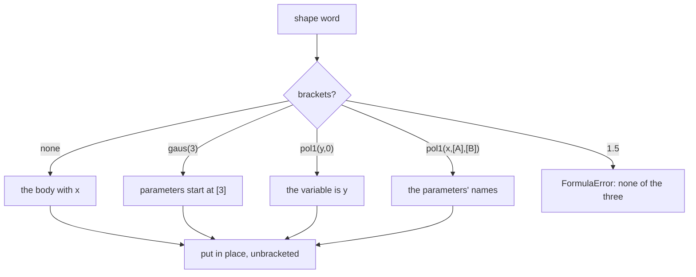

`TF1("f", "gaus")` is a Gaussian because `TFormula` rewrites the word **before** it parses
anything, and this kit does the same rewriting with ROOT's own bodies. Two of that rewriting's
consequences surprise a reader, and both were measured against the 6.40 oracle rather than argued.



## In place, not bracketed

A shape goes into the formula as ROOT puts it there — **in place**, with no brackets round it.
So `x/gaus(0)` is

```
x/[p0]*exp(-0.5*((x-[p1])/[p2])*((x-[p1])/[p2]))
```

which is `x` divided by the Gaussian's *constant* and then multiplied by its exponential — **not**
`x` divided by the whole Gaussian the text seems to say. ROOT's own answer is that string
character for character: `TF1("f","x/gaus(0)",0,1).GetExpFormula()` under the 6.40 oracle prints
exactly it. `x*gaus(0)` loses the brackets the same way. The one shape ROOT *does* bracket is the
series (`polN`, and `chebN` is a call into `ROOT::Math` anyway): `2*pol2` is
`2*([p0]+[p1]*x+[p2]*TMath::Sq(x))`.

## What a shape's brackets may hold

Three things, and nothing else:

- **where its parameters start** — `gaus(3)` is a Gaussian whose parameters are `[3]`, `[4]` and
  `[5]`, which is how ROOT's own tests put a second Gaussian beside a first (the formula then has
  six parameters, and the first three belong to whatever came before);
- **which variable it is in** — `pol1(y,0)`, ROOT's way of fitting a projection against its other
  axis;
- **what its parameters are called** — `pol1(x,[A],[B])`, which is what `GetParameter("A")` then
  asks for.

A fourth kind of argument is refused with all three spelled out, plus ROOT's own note that a real
C++ function is written with its scope (`TMath::Gaus(x,mean,sigma)`) rather than as a shape.

`x[1]` and `x[2]` are `y` and `z` — ROOT's other spelling of a variable — and `x[3]` is refused by
name. A `[` with no `]`, and a shape's `(` with no `)`, are each refused with the **character**
they opened at, which is what a caller needs to find them in a long formula.

## The names a formula gets

A formula that is nothing but one shape gets **ROOT's names** for its parameters (`Constant`,
`Mean`, `Sigma` for a Gaussian) and is marked *predefined*, which is what a fit's parameter order
and the closed-form integral hang off. Every other parameter written by number is `p` and its
number. A formula read back from a file keeps the names it came with: its text already carries
them, so nothing is renamed — and the shape's word is gone by then, which is why `recognised()`
works the shape out by writing each one out under the same names and comparing the text.
