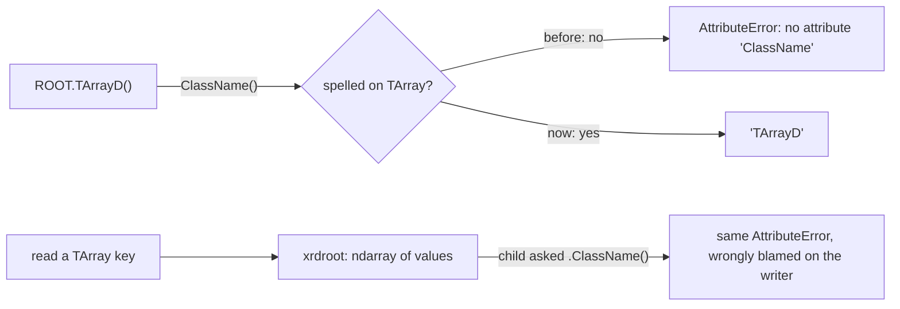

Every `TArray` subclass needs `ClassName`, and a reader may legitimately hand back *values* instead of an object — both bit the same round-trip check in `tools/io_matrix.py`. `TArray` now spells `ClassName` once (`src/xrdroot/pyroot/vectors.py:193`, returning `type(self).__name__`), and a bare `TArray` key reads back from xrdroot as the numbers it holds, so any code that calls `.ClassName()` on a read object must tolerate a values type.

```python
# src/xrdroot/pyroot/vectors.py
class TArray(TObject):
    def ClassName(self) -> str:
        """This array's ROOT class name: ``TArrayD`` for an array of doubles."""
        return type(self).__name__
```

## Why both halves mattered

`TObject.ClassName` reaches for a class dictionary the array classes never fill, so `ROOT.TArrayD().ClassName()` raised `AttributeError` — and anything that writes an object the ROOT way asks exactly that question. The matrix's *read* child then made it look like a writer bug: it called `.ClassName()` on the object xrdroot returned, and xrdroot returns a bare `TArray` key as a `numpy.ndarray` of its values, which is a correct read.



## How to check

```bash
PYTHONPATH=$PWD/src python -c "import xrdroot.pyroot as R; print([getattr(R,n)().ClassName() for n in ('TArrayD','TArrayI','TArrayF')])"
pytest -q tests/ -k "vectors or tarray"        # 63 passed
python -m tools.io_matrix --oracle-prefix ~/.local/root-oracle --classes TArrayD,TArrayI,TArrayF
```

The matrix's last run reads **xrdroot -> ROOT PASS** for all three; the reverse direction returns nothing, which is the reader's gap and not this one.
