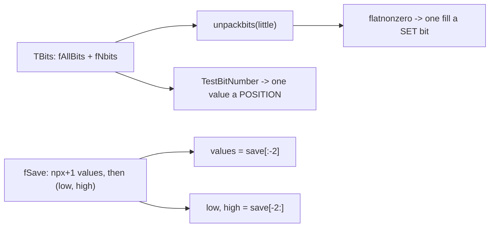

Two of ROOT's members are not arrays of one value per entry, and both are read as if they
were until a test says otherwise. A **`TBits`** is *drawn*, one fill per bit that is set, and
a **function of code's `fSave`** is its values at `fNpx + 1` points *followed by the two ends
they span* — so the last two entries are the range, not values.

## A `TBits` is drawn, so a name of one is a row of bit numbers

`TSelectorDraw::ProcessFillObject` fills the number of each bit a `TBits` holds **set**, one
fill a bit — it is ROOT's histogram of the trigger bits, not a value per object. So a member
whose class has `fNbits`, `fNbytes` and `fAllBits` reads as the *numbers of its set bits*:
with `fNbits` 10 and `fAllBits` `[0b00000101, 0b00000010]`, the row is `[0, 2, 9]` and not
`101` or a ten-value array. `TestBitNumber(n)` asks about one bit instead, so what it reads is
a value per *position* — ten of them, `1` where the bit is set — which is what ROOT's own
macro selects on (`event.fTriggerBits.TestBitNumber(28)`).

`xrdroot.formula.objects` offers both names for such a member (`_offer_bits`), and
`_bits_of` is the unpacking: `np.unpackbits(held, bitorder="little")[:count]`, because
`TBits` numbers its bits from the low bit of the first byte.

Two refusals belong with it. A batch whose entries disagree about holding the member is
refused (`_consistent`), and a value that is no object at all gets the `TBits` sentence —
"an expression is read entry for entry, so select the entries that all hold it" — because
neither can be drawn.

## `fSave` is `fNpx + 1` values and then the range

ROOT cannot write code, so a `TF1` defined by C++ is written as the function **sampled**:
`fNpx + 1` evenly spaced values, **then the two ends they span**. For the default `fNpx` of
100 that is 103 doubles, and the last two are `(0.0, 4.0)` for a function over `[0, 4]` —
not values of the function at all. `TF1::GetSave` interpolates between the samples and
returns zero outside the range.

So `saved.usable` splits it as `values[:-2], values[-2], values[-1]`, and a file that
repeats its upper end (`values[-1] == values[-2]`) has its samples at a histogram's bin
centres, which needs that histogram's axis and is refused by name.

Reading `fSave` as "one value per point" gives a function that is right for its first
`fNpx + 1` points and then two nonsense ones, which is the kind of wrong that a plot hides.
