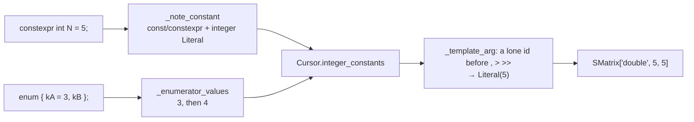

A template argument that names an **integral constant** is that number: `constexpr int N = 5;` then `SMatrix<double, N, N>` is `SMatrix<double, 5, 5>`, and C++ folds it before anything is instantiated. The translator read three of the four spellings as *names* instead, so a shape-taking library was asked to name a matrix by `['N', 'N']`.

## The four spellings, measured

| written | before | after |
|---|---|---|
| `#define N 5` | `5` | `5` (the preprocessor already replaced it) |
| `constexpr int N = 5;` | `N` — an undefined Python name | `5` |
| `const int N = 5;` | `N` | `5` |
| `enum { N = 5 };` | `'N'` — read as a *type*, spelled as a string | `5` |
| `enum { kA = 3, kB };` | `'kA', 'kB'` | `3, 4` (an enumerator without a value is the one before plus one; the first is 0) |
| `constexpr int N = 2 + 3;` | `N` | `N` — not folded: the value is an expression the parser does not work out here |
| `int N = 5;` | `N` | `N` — right: a non-const variable is no constant expression |

## How it is done

- `Cursor.integer_constants` is the table: a name to the number it stands for.
- `parse_stmt.declarators` and `parse_decl._variables` both call `_note_constant`, which registers a declaration whose specifiers carry `const`/`constexpr` **and** whose initialiser is an integer `Literal`. Both paths are needed: a statement's declaration and a file-scope one are read by different functions.
- `parse_decl._enumerators` registers each enumerator through `_enumerator_values`: a literal is its number, one without a value steps from the one before, and an expression leaves itself **and the ones after it** unnamed.
- `parse_types._template_arg` asks the table **first**, for a lone identifier followed by `,`, `>` or `>>` — before `_typed_arg`, because the parser lists an enumerator's name as a *type* and that reading wins otherwise.

## The crash the whole-kind run caught

The first shape read `value = None if written is not None else value + 1`, so an enumerator written as an **expression** (`kB = kSomeOther`) poisoned the next implicit one and raised `unsupported operand type(s) for +: 'NoneType' and 'int'`. That turned `roottest/root/meta/autoloading/headerParsingOnDemand/scopedEnums-libgen-build` from PASS into UNSUPPORTED — a lost PASS that only a whole run of the kind shows. `_enumerator_values` keeps the `None` state explicit, and the area was re-measured to PASS.

## What it changed

`smatrix/Inversion` moved off `TypeError: "SMatrix<double,Name(...)` and onto the matrix representation itself (`SMatrix<double,5,5,MatRepSym<double,5>>`, refused by the pythonization) — the constants are right and the wall is the library's now, recorded as `W0-256`. `tests/test_cint_templates.py` pins the constexpr, the const, the plain variable (not folded) and both enumerator shapes.
