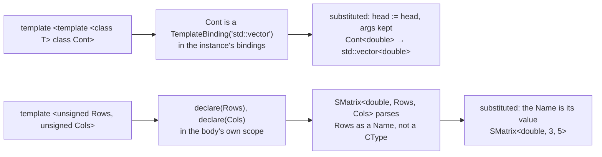

A `template <template <class T> class Cont>` parameter stands for a **class template**, not a type, and a value template parameter is a **value inside its own body** — two facts the translator used to lose, which is why ROOT's `io/cpp11Containers` and `math/smatrix` tests stopped at a name rather than at their real work.

## What the translator used to do

A `Cont` binding was a plain `CType('std::vector')`, and `substitute.substituted` applies a binding only when the `CType` has **no** template arguments:

```python
bound = bindings.get(ctype.name) if not ctype.args else None
```

`Cont<double>` has arguments, so it was left whole and the emitter wrote `ROOT.Cont['double']` — the harness's `AttributeError: ROOT has Cont; xrdroot.pyroot does not yet`, and four `io/cpp11Containers` tests refused. The same directory showed the second loss: with `template <unsigned int Rows, unsigned int Cols>`, `SMatrix<double, Rows, Cols>` read `Rows` as a *type* (it was no known value in the body), so the `SMatrix` pythonization was asked to name a matrix by `['ROWS', 'COLS']`.

## The rules



- `substitute.TemplateBinding(head)` says what such a parameter's argument *is*: a template's name. `substituted` replaces the head and keeps the arguments; a bare `Cont` in a value position stays a name, because it is no value.
- `parse_decl._class_template_parameter` already read the parameter; it now records the name in `Function.class_templates` (and `ClassDecl.class_templates`), and `instantiate.Templates.templated` wraps that binding before the body is copied.
- `parse_decl._template` declares each **value** parameter as a variable while its own body is read (`push`/`declare`/`pop`), so a template argument that names one is a value — which `substituted` already knew how to fold.

## What it changed

`io/cpp11Containers`' four tests went from UNSUPPORTED to FAIL: they now run and stop at the *writer*, which refuses a `std::list<double>` handed to `WriteObject` (`a list<double> is not something this writer puts in a ROOT file`) — a real missing capability, not a translator one. `math/smatrix/Operations` went from `testOperations.cxx:95` to `matrix_op.h:202` (`'SMatrix_5_5_0' object has no attribute 'Inverse'`, ROOT's `SMatrix::Inverse(ifail)`), and `testSMatrix` keeps its own named refusal (`SMatrixIdentity()` needs the declared shape). None of the six passes yet; the walls are now library work with names.

## Where it lives

| Question | Code |
|---|---|
| What does `Cont<double>` mean here? | `pycxx/substitute.py::TemplateBinding`, `substituted` |
| Which parameters are templates? | `pycxx/nodes.py::Function.class_templates`, `parse_decl._class_template_parameter` |
| Who binds them | `pycxx/instantiate.py::Templates.templated` |
| Is `Rows` a value here? | `pycxx/parse_decl.py::_template`'s `push`/`declare`/`pop` |

`tests/test_cint_templates.py` pins both rules and runs the first against `cintfake`'s `std::vector`.
