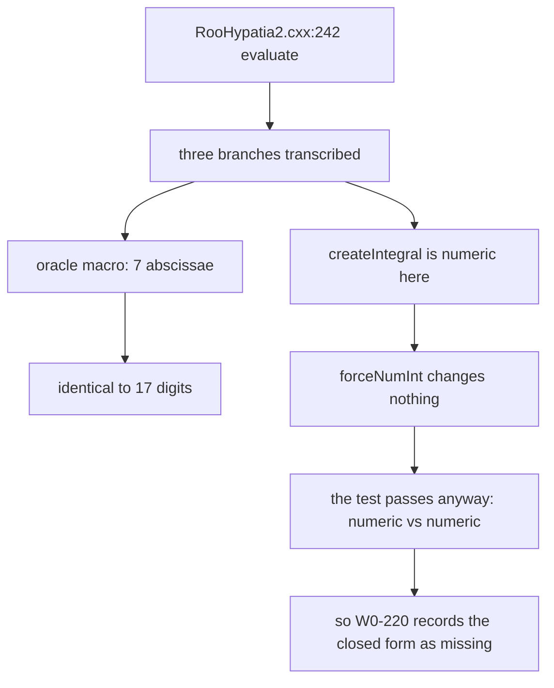

ROOT's own `evaluate()` transcribed line for line reproduces its numbers to the last of 17 digits — and a test that compares an "analytic" integral against a numeric one passes here even when both roads are numeric, so the *test passing* is not evidence the closed form exists.

`roofit/roofitmore/src/RooHypatia2.cxx:242` is three branches: the core `(1 + d^2/sigma^2)^(lambda-1/2)` between the cut points `a*sigma` and `a2*sigma`, and a tail `A (B -+ d)^-n` beyond each, with `A = k1 (B +- edge)^n` and `B` from `k1/k2` — `k1` the core's value at the edge and `k2` its slope. Written as `roofit/pdfs/hypatia.py` and asked the same seven abscissae as a macro run on the 6.40 oracle (`~/.local/root-oracle/bin/root -l -b -q hyp.C`), it answers the identical 17 digits at every one, and the integral over the range differs by 7.3e-8.

## What to do with a test like this

1. **Read the test's subject before believing its PASS.** This one compares `createIntegral` with a `forceNumInt` clone; where the engine has no closed forms at all, both sides are the same integral and the assertion cannot fail on the thing it is named for.
2. **Say it in the class's docstring and in the queue** — `RooHypatia2`'s says `createIntegral` is numeric and `W0-220` says what the closed form needs — so the next reader does not take the PASS for a closed form.
3. **Measure the numbers against the oracle anyway**: the shape being ROOT's is the part that matters, and it is checkable even when the integration road is not.
4. The `RooNumIntConfig` surface ROOT's test uses (`defaultIntegratorConfig`, `setEpsAbs`/`setEpsRel`, `getConfigSection(name).setRealValue`, `setIntegratorConfig`, `forceNumInt`) is worth checking *first*: all of it existed here, which is why one file was enough.
