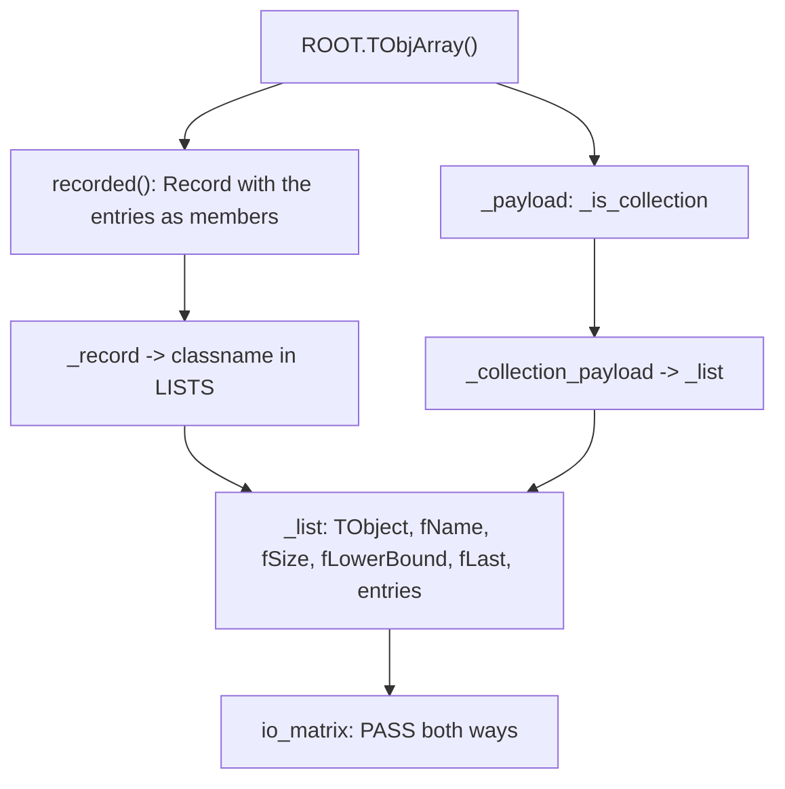

A `TObjArray` crosses the file boundary once the writer's list shape is told about it: adding `"TObjArray"` to `LISTS` in `src/xrdroot/writer.py` makes `_record` and the `Record` route write it through `_list`, and the payload then only has to supply the entries plus the two indices a `TObjArray` keeps before them — `fLowerBound` 0 and `fLast` (entries − 1, so −1 when empty).

```python
LISTS = ("TList", "THashList", "TObjArray")     # src/xrdroot/writer.py:144

buf.i32(len(held))
if classname == "TObjArray":                     # after fSize, before the entries
    buf.i32(0)                                   # fLowerBound
    buf.i32(len(held) - 1)                       # fLast
```

## Why the earlier attempts failed

Two things looked like the obstacle and were not:

- `unwrap(ROOT.TObjArray()).members` is **None** on a fresh engine, so `_is_collection` had to test `getattr(obj, "members", None) is None`, not `hasattr`.
- `src/xrdroot/pyroot/core/records.py:93` maps `"TObjArray": _held`, so `recorded()` produces a `Record` whose members are the *entries*. That is correct — the writer's list shape is what consumes it, which is why `LISTS` was the real fix and a bespoke payload was not.



## How it is proved

```bash
python -m tools.io_matrix --oracle-prefix ~/.local/root-oracle --classes TObjArray --out DIR
# 1 of 1 classes cross the boundary both ways
```

A `TObjArray` reads back as its **entries**, not as a dict: a round-trip test asserts `list(handle["a"]) == []`, and members-based assertions (`read["fSize"]`) fail with `TypeError: list indices must be integers`.
