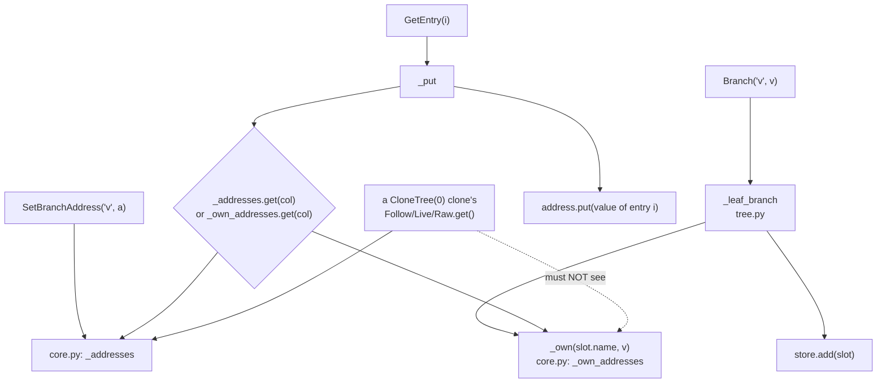

A TTree filled in memory never refilled the object its branch was declared with, so `Branch("v", v)` → `Fill()` × N → `GetEntry(i)` left `v` holding the **last** entry for every `i`. ROOT does refill it, and two of its own tests depend on that. The fix keeps a branch's own object apart from `SetBranchAddress`'s bindings, because those two maps are read by different callers.



## Where the two maps live

`src/xrdroot/pyroot/trees/core.py` (the reading base's `__init__`) now holds:

```python
self._addresses: dict[str, Address] = {}      # SetBranchAddress's, which a clone reads through
self._own_addresses: dict[str, Address] = {}  # the branch's own object, for this tree
```

`TTree::Branch` → `_leaf_branch` (`src/xrdroot/pyroot/trees/tree.py`, right after `store.add(slot)`) calls `self._own(slot.name, one)` — `slot.name`, not `leaf.column`: the leaflist `Leaf` in that function has no `.column` field, and `_columns()` for a memory tree is the engine's branch labels. `_put` in `src/xrdroot/pyroot/trees/reading.py` reads both:

```python
address = self._addresses.get(column) or self._own_addresses.get(column)
```

## Why they cannot be one map

A `CloneTree(0)` clone's slots are `Follow`/`Live`/`Raw` addresses in `src/xrdroot/pyroot/trees/copying.py` whose `get()` first consults `self.tree._addresses`. Merge the maps and the clone reads its source's live fill buffer, so `clone.Fill()` before `parent.GetEntry(i)` stops raising "has read none yet" — `tests/test_pyroot_trees_friends.py::test_clone_tree_of_nothing_then_fill_copies_the_entries_the_loop_picks` fails on exactly that line. An early attempt carrying an `is_clone = True` marker on those classes was reverted: the marker has to be kept in step with every new address class, while the separate map cannot drift.

## The std::set branch that came with it

`std::set` needed three seams and now has all three: `is_set` beside `is_vector` in `src/xrdroot/cppstd/containers.py`, re-exported through `src/xrdroot/pyroot/stl.py`; a `Collection(Address)` in `src/xrdroot/pyroot/trees/addresses.py` (`get` returns `list(given)`, `put` clears then re-inserts) reached from `address_of`; and the read-back above. Without the read-back the set branch silently returned the last entry.

## How to check it

```bash
. .venv/bin/activate && export PYTHONPATH=$PWD/src
python -m tools.rootsuite run --root ~/src/.xrdroot-scratch/rootsrc -j 3 \
  --xrdroot-src <worktree>/src --out ~/.cache/xrdroot-runs/goal-set \
  --only 'pyunittest/bindings/pyroot/pythonizations/pyroot_pyz_stl_set' \
  --only 'pyunittest/bindings/pyroot/pythonizations/pyroot_pyz_stl_vector'
```

`pyroot_pyz_stl_set` PASSES at `a3761705`; `pyroot_pyz_stl_vector` goes from 3 failing cases to 2 (its remaining two compare a `vector<char>`'s rendering, not its read-back). The repository-side regression is `tests/test_pyroot_trees_collections.py::test_a_tree_filled_in_memory_reads_each_entry_back_into_its_branch_object`, which fills `[]`, `[1]`, `[1, 2]` into a `std::vector<int>` and a `std::set<int>` and reads all three back.
