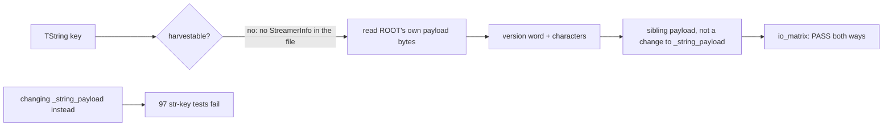

A `TString` written by ROOT carries **no class description at all** — `TFile::GetStreamerInfoList()` returns nothing for a donor holding one — because ROOT has the class built in. So `tools/harvest_infos.py` cannot supply its layout, the `INFOS["TString"]` entry in `winfo` (checksum 95257, version 2, **no elements**) is not something a donor confirms, and the byte format has to be taken from ROOT's own output rather than harvested.

```bash
~/.local/root-oracle/bin/python -c "
import ROOT
f = ROOT.TFile.Open('/tmp/ts.root','RECREATE'); ROOT.TString('hello'); f.WriteObject(ROOT.TString('hello'),'s'); f.Close()"
python -m tools.harvest_infos /tmp/ts.root      # -> 'nothing read from /tmp/ts.root'
```

Note also that `ROOT.TString` has no `.Write` in PyROOT; `f.WriteObject(obj, name)` is the way to put one in a file.

## What to do instead of harvesting

1. Write a `TString` key with the oracle, then dump the key's payload bytes and compare them with what the writer emits (`buf.u16(version); buf.string(text)`). The version word is the one thing that cannot be guessed: ROOT reads it before the characters, and a wrong one makes the key unreadable rather than wrong.
2. Keep the payload a **sibling** of `_string_payload`, never a change to it: a plain Python `str` is the writer's most-used key type, and teaching `_string_payload` to emit a `TString` broke 97 tests in one run (every `str` key became a `TString`).
3. Judge with `python -m tools.io_matrix --oracle-prefix ~/.local/root-oracle --classes TString`; a self-round-trip proves nothing here because xrdroot reads a `TString` key back as a plain `str`.



## Why this is worth a note

The other four gaps are ordinary: a layout plus a payload. `TString` is the one class whose description the file does **not** carry, and every instinct from the previous classes — harvest, then map — silently produces an empty element list that looks like a valid layout.
