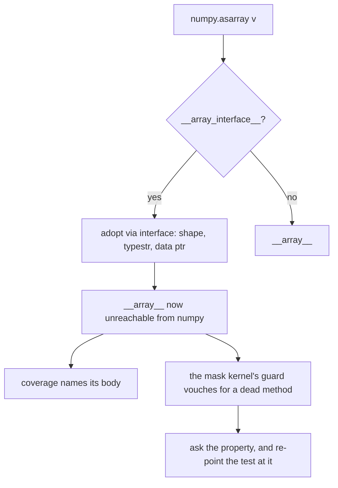

A `std::vector` of numbers answers NumPy's `__array_interface__`, and once it does, `__array__` is dead for numpy — so anything asking "has the program replaced the conversion?" must ask about the property, not the method.

ROOT builds the interface in `bindings/pyroot/pythonizations/python/ROOT/_pythonization/_rvec.py`'s `get_array_interface`, and one line of it is load-bearing for emptiness: an **empty** vector reports the data pointer **1**, because, in ROOT's own comment, *"Numpy breaks for data pointer of 0 even though the array is empty"*. The flag beside the address is `False`, so the array is writable and a write through it lands in the vector.

The trap is on this side of the fence. `numpy.asarray` consults `__array_interface__` **before** `__array__`, so adding the interface silently retires `__array__`: it becomes unreachable from numpy, coverage reports its body as uncovered, and the RDF mask kernel's fast-path guard — a list of `(class, method, module, owner)` triples checking that a program has not replaced an RVec's conversion — keeps vouching for a method nothing calls. That guard also has to change shape, because `inspect.getattr_static(klass, '__array_interface__')` is a **property**, which has no `__module__`; check `type(held) is property and _function(held.fget, module, '_Vector.__array_interface__')`.

## What to check when adding an array interface

1. Delete the `__array__` it retires, or keep it only if something calls it by name.
2. Grep for guards and contracts that name `__array__` — `pyroot/rdf/masknative.py` here — and for tests that monkeypatch it.
3. Keep ROOT's per-type rule: only a *fundamental* element type gets the interface, so `vector<std::string>` answers none.
4. Measure the empty case against ROOT's address-1 rule rather than against "no data".
