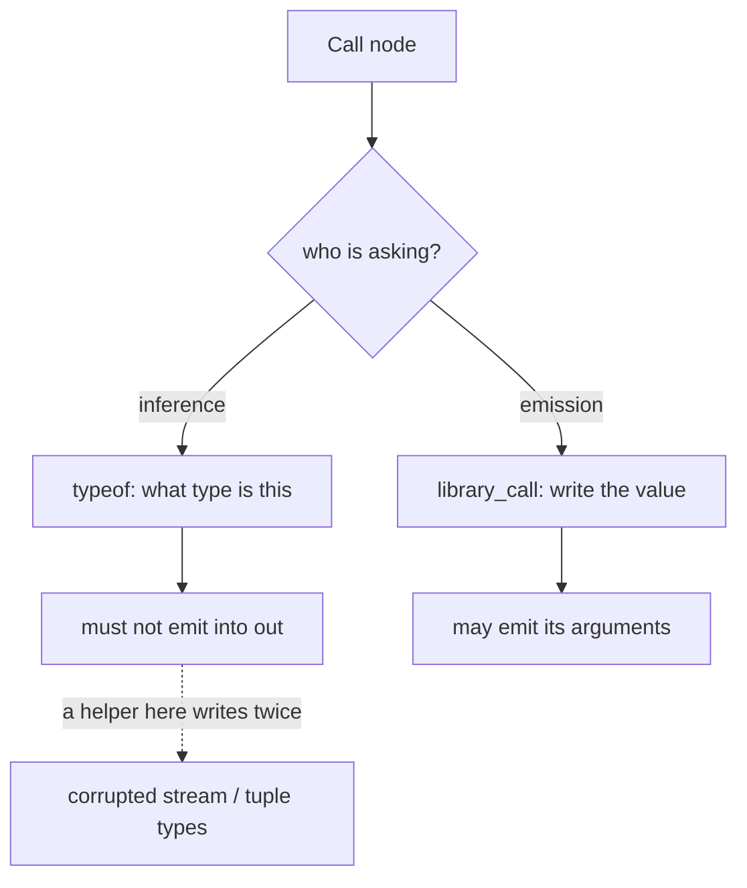

An emitter helper that *writes into the macro* - `self.arguments(node)`, `self.value(...)`, `self.out.line(...)` - must be called only from the path that emits a value. `CallEmitter.named_call` is asked the same question by the inferencer, so a helper placed there runs twice: once to answer "what type is this call", once to write it. In round 95 that turned every `auto x = f()` in a translated program into a `tuple`, and the whole file failed with `'tuple' object has no attribute 'dims'` - 403 lines away from the line that caused it. The fix was to move the check into `library_call`, which only the emit path reaches.



## The second shape, in the same round

A slice-based rewrite whose two indices can be in the wrong order silently **duplicates** the chunk between them:

```python
text[:start] + new + text[end:]   # start AFTER end: the block is copied twice
```

`graphs.py` grew 403 lines that way (a whole class region repeated, with two `Sort` methods, the second shadowing the first), and nothing failed loudly - the file still parsed and the first `Sort` still worked. **`git diff --stat` after every scripted edit is the check**: a number bigger than the change you meant is the duplication.

## What to do

1. Before adding a decision to `emit_calls`, ask which functions the *inferencer* also calls (`named_call`, `library_call`, `_typedef_cast`) and put the new code on the emit-only side.
2. After any scripted edit, read `git diff --stat`: `403 insertions` for a 20-line change means a bad slice.
3. A duplicated method definition is invisible at runtime - the later one wins - so a `rg -c "    def <name>"` count is worth more than a green test run.
