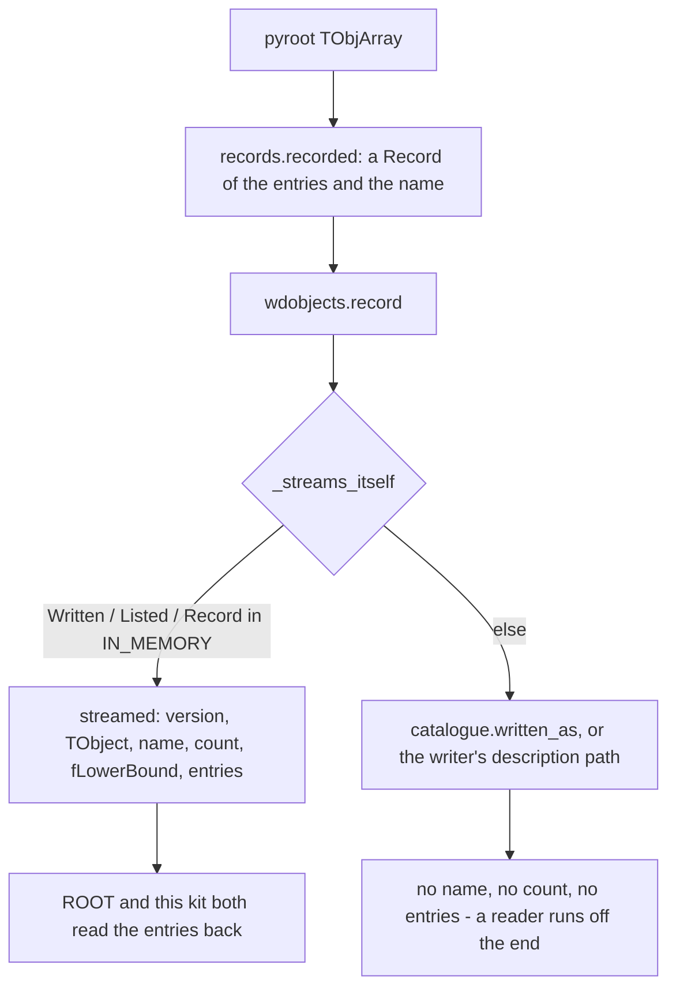

`wdobjects` writes an object of a class the program did not declare by the layout the file's streamer information
describes it with - unless the class streams itself. A `TObjArray`, a `TList` and a `THashList` are in that second
group: ROOT's `TObjArray::Streamer` (`core/cont/src/TObjArray.cxx:448-497`) is `WriteVersion(..., kTRUE)`,
`TObject::Streamer`, `fName.Streamer`, `nobjects`, `fLowerBound`, and then each `b << fCont[i]`, and the description a
file carries for the class describes the *base* and two members only. Write an array held in memory by its
description and the record holds no name, no count and no entry at all; the reader then walks off the end of it.

So the pyroot layer hands the engine **the entries and the name**, as a `Record` of the entries whose `name` is the
collection's (`pyroot/core/records.py`: `MEMBERS["TObjArray"] = _held`, and `NAMED_COLLECTIONS` so `TObjArray` keeps
its name the way `TList` does), and `wdobjects._streams_itself` routes it to `streamed`, the same writer a collection
read out of a file goes back through. `IN_MEMORY` is the set of classes that take this road - `TObjArray` today -
because a `TList` held in memory goes through `writer._list`, which is passed the collection's objects directly.

## The reading side of the same file

`Event`'s `UShortVector` derives from `std::vector<UShort_t>`, so a read leaves a plain Python list where the
elements go. `declared._refilled` asked the container for `push_back`, then for `insert` - and a list's `insert` takes
a place and an item, so the read died with `TypeError: insert expected 2 arguments, got 1`. `_appender` answers
`append` for a list and `insert` for a container of C++'s own. Two different failures, one file:
`roottest/root/io/bigevent/read` needed both.

## What is still not written

A `TObjArray` handed over as a file **key** (`Write("mine", kSingleKey)`) has no branch here: `writer._record_payload`
writes a `TList` through `_list` but has no array shape, so the call is refused with `a TObjArray here is a list
rather than the dict of members writing one starts from` (`W0-237`). The shape it needs is the one `_entry_into`
already writes for a `TStreamerInfo`'s element array - version 3, `tobject`, `string(name)`, `i32(count)`, `i32(0)`,
then each entry through `_listed`.
