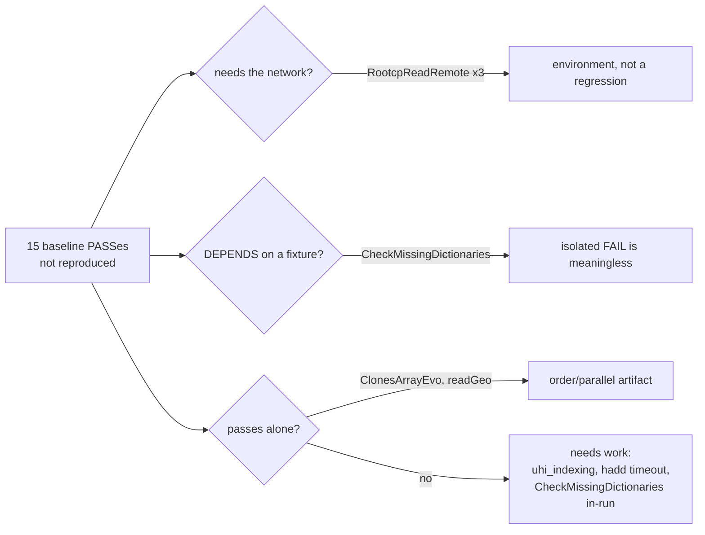

Re-running a roottest test alone to check whether it is a real failure or load flakiness gives the wrong answer for any test that has a `DEPENDS` on a fixture which *builds* something. `roottest/root/io/withoutDictionaries/CheckMissingDictionaries` DEPENDS on `VectorDMWriteWithoutDictionary`, whose `-libgen-build` step generates the dictionary that declares `ECont`; run alone, the macro sees a dictless class with no members, returns 1, and looks like a regression. Check `DEPENDS` in the test's `CMakeLists.txt` before believing an isolated failure.

## How to isolate honestly

```bash
grep -n -B3 -A3 "<TestName>" ROOTSRC/roottest/<path>/CMakeLists.txt   # the DEPENDS line
```

Then either run the fixture and the test together (`--only 'roottest/<dir>/*'` keeps them in one working copy), or accept that the isolated result means nothing. The same applies to any test whose `.ref` was produced by a sibling: `create-r`, `test-rc*`, `hsimple`-dependent tests all share a working copy by design.

## What a real triage of 15 "lost" PASSes looked like



Of 15, three needed the network, two passed alone, one was a fixture artefact, three were pre-existing divergences kept by hand (`baseClass_53410_v1/v2`, `execBaseClass_v2`), one is out of scope (`multicore/ttree_write`), which leaves three that need a human — and the honest state of the baseline is "62 gained, 3 unresolved", not "62 gained, 15 lost" and not "the run is the new baseline".

## Why it matters

`tools/rootsuite baseline` rewrites the whole file. Running it after a triage like this would have replaced three real PASSes with FAILs because of a fixture artefact and a network dependency, and the ratchet would then treat those as the new floor. Triage first; bank what survives it.
