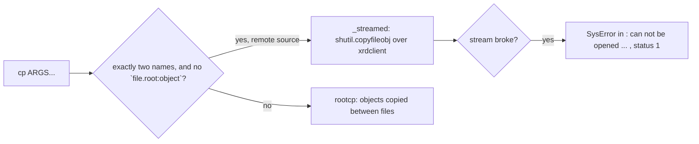

`xrdroot cp` is **`rootcp`, not `xrdcp`**: it copies ROOT *objects* between ROOT files. Handed a remote dataset and a plain destination it rewrites the file's objects, which produced **510 MB of nonsense out of a 2.2 GB NanoAOD** and a file whose first bytes were not `root`. Since that is the first command anyone types at a remote dataset, a pair naming no object inside either is now **streamed byte for byte**.

```bash
# a whole file: bytes, as xrdcp does
python -m xrdroot cp root://eospublic.cern.ch//eos/root-eos/h1/dstarmb.root /tmp/h1copy.root
head -c 4 /tmp/h1copy.root            # root
# an object inside a file: still rootcp
python -m xrdroot cp source.root:hist dest.root
```



## Why the mistake was easy

Both tools take `SOURCE DEST`, both end in `.root`, and the object syntax `file.root:hist` only *sometimes* appears. The rule that separates them is in `_names_an_object`: a colon anywhere **past the URL's own scheme** — `root://host//f.root` is a file, `root://host//f.root:hist` is an object inside it.

## Two things the fix needed that are easy to miss

- the components gate rejected `xrdclient` in `src/xrdroot/cli/cp.py` (`app -> xrdclient [external-undeclared]`) until `hard = ["numpy", "xrdclient"]` was added under `[tool.xrdroot.components.ownership.app]` in `pyproject.toml`;
- the stream has no `size` attribute, so the copy is a `copyfileobj` and not an allocation of a known length; a broken stream has to raise the same ROOT-worded refusal as a missing file, which is what `test_a_copy_that_opens_but_fails_while_reading_is_reported` pins.
