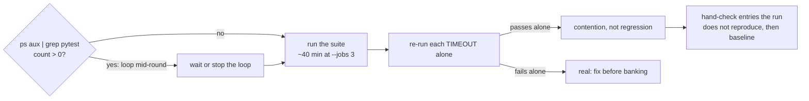

A full-suite baseline cannot be measured while the ROOT loop is running its own round: 16 processes on this machine took the run to 614 of 2820 tests in 50 minutes with six TIMEOUTs, against roughly 40 minutes for the whole suite when idle. The timeouts are contention, not regressions, and a `baseline.json` written from that run would record them as lost PASSes. Check for the loop first, and stop the run rather than bank a number you cannot defend.



## How to tell the two apart before starting

```bash
ps aux | grep -E 'pytest|ralph' | grep -v grep | grep -c xrdroot   # 0 = the machine is yours
grep -cE '^\[' RUN_DIR/suite.log                                    # progress rate
grep -c TIMEOUT RUN_DIR/suite.log                                   # rising fast = contention
```

A run that takes 50 minutes to reach 22 % of the suite is not a slow suite, it is a loaded machine; the same suite at `--jobs 3` finishes in about 40 minutes alone. Six timeouts in the first 600 tests is the same signal — one or two are normal under four jobs.

## What to do instead

- Run the suite when the loop is idle, or stop the loop for the duration rather than shrinking `--jobs` until it fits: measuring is CPU and I/O bound end to end, and the loop's rounds are the thing that changes the numbers anyway.
- Per the project's rule, re-run each TIMEOUT alone before calling it a regression — under load they pass alone, and that is the only evidence that counts.
- A baseline is only worth what the run behind it is worth: `tools/rootsuite baseline` rewrites the whole file, so an unreproducible PASS disappears silently and a contention TIMEOUT lands as a lost PASS.

## Why it matters here

The committed baseline predates the merges of the last day: runs since have shown 1526 PASS against a banked 1460, with 80 gained and 14 not reproduced. Refreshing it needs a quiet machine and a hand-check of the entries the run does not reproduce — the number is the project's only claim about progress, so a distorted one is worse than a stale one.
