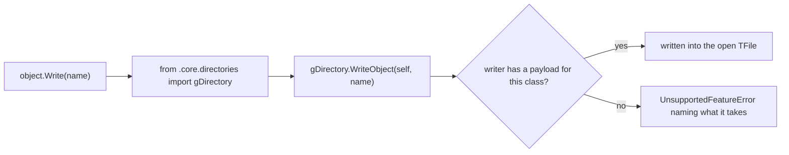

`gDirectory` already exists in xrdroot — `src/xrdroot/pyroot/core/directories.py:27`, an `_CurrentDirectory` exported as `ROOT.gDirectory` — so a `TObject::Write` has ROOT's own route to the open file. A search that says otherwise is usually a bad `rg` glob: `src/xrdroot/pyroot/*.py src/xrdroot/pyroot/core/__init__.py` never looks inside `core/directories.py`, and I wrongly reported "no gDirectory" from exactly that mistake.

```bash
# the right search: the whole package, not a shell glob
rg -rn "gDirectory" src/xrdroot/pyroot
# the cheap confirmation
PYTHONPATH=$PWD/src python -c "import xrdroot.pyroot as R; print(type(R.gDirectory).__name__)"   # _CurrentDirectory
```



## What a class needs for `Write` to reach a file

| piece | where |
|---|---|
| the route | `gDirectory.WriteObject(obj, name)` - already there |
| a `TObject` face | `ClassName()`, `GetName()` - a directory asks before it writes; `TFoam` gained both |
| a payload | the writer's own, and this is the part that refuses when a class has no layout |

## The lesson worth keeping

Search the **package**, not a glob of it: `rg -rn "NAME" src/xrdroot/pyroot` finds what `src/xrdroot/pyroot/*.py` cannot, and a "missing feature" claim from the narrower command can be simply false. Two minutes of looking beat a design session built on a bad negative result — this one had me planning a whole `gDirectory` feature that was already implemented.
