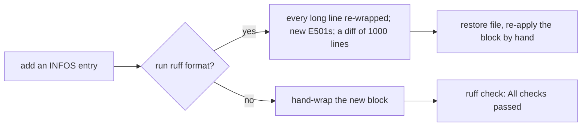

`ruff format` on `src/xrdroot/winfo.py` rewrites the whole 2700-line harvested table, including entries nobody touched — and the reformatted lines then trip `E501` in `ruff check`. On a generated table, format the lines you add by hand and never run the formatter over the file.

```text
$ ruff format src/xrdroot/winfo.py && ruff check src tests
Found 4 errors.                      # E501 at lines that were already fine
  --> src/xrdroot/winfo.py:2590:101  # "If the algorithm is allowed to use automatic (relaxed) binning ..."
```

## What to do instead

1. Keep each added element on lines that fit inside 100 characters yourself — a short title (`'row lower bound'` rather than `'lower bound of the row index'`) is usually all it takes.
2. Check with `ruff check src tests` alone. If it says *one file would be reformatted*, leave it: the table's own layout is not ruff's to decide.
3. If the formatter was already run, restore the file and re-apply only your block:
   `git show HEAD~1:src/xrdroot/winfo.py > src/xrdroot/winfo.py`, then paste the new `INFOS.update({...})` block again.



## Why it matters

The file is generated knowledge with one entry per line group; a formatter pass makes the real change (two classes) invisible inside a whole-file diff, and on a shared checkout it collides with the other session editing the same file — which is exactly how the `TMatrixF` commit ended up needing a rebase it could not complete.
