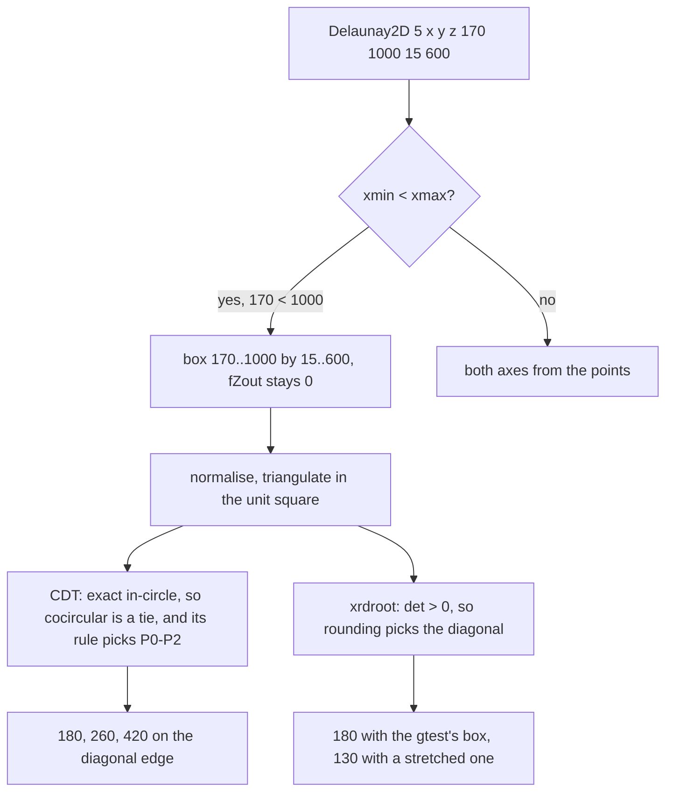

`gtest/math/mathcore/testDelaunay2D` was not failing for a numerics reason: `ROOT.Math.Delaunay2D` did not
exist at all (`AttributeError: module 'xrdroot.pyroot.core.rmath' has no attribute 'Delaunay2D'`), and the
engine it should wrap, `src/xrdroot/delaunay.py`, already reproduced all fifteen of the test's values. Read
`math/mathcore/src/Delaunay2D.cxx` and `inc/Math/Delaunay2D.h:132` before reasoning about the numbers, and ask
`~/.local/root-oracle/bin/root` before believing any "ROOT must interpolate z barycentrically and nothing
else" hypothesis.

The test's points are `x={750,1000,1000,900,750}`, `y={400,400,500,600,500}`, `z={100,100,500,600,250}`,
built as `Delaunay2D d(5,x,y,z,170.,1000.,15.,600.)`. The constructor is
`(n, x, y, z, xmin, xmax, ymin, ymax)` with **no `zout` parameter**, and `fZout = 0.` (`Delaunay2D.cxx:46`):
`170.` is `xmin`. That is why the three "interpolate outside triangles" assertions expect `0.`, never `170.`;
`SetZOuterValue` is the only way to set it. The box is used only when `xmin < xmax` (`:71`), and otherwise both
axes are measured from the points - both, since a caller who gives no box gives no y range either.

## The values that look wrong and are not

`P0..P4` form a 250x100 axis-aligned rectangle (`P0,P1,P2,P4`) with a triangle above it, and the rectangle's
four corners all lie on the circle of radius `sqrt(18125)` about `(875, 450)`: they are **cocircular**, so
both diagonals are legal Delaunay triangulations. ROOT's bundled CDT (`math/mathcore/src/CDT/`, used when
`HAS_CGAL` is undefined) picks **P0-P2**. That is why the three "diagonal edge" points `(800,420)`,
`(850,440)`, `(950,480)` - which lie on `y = 0.4x + 100`, the P0-P2 line - answer 180, 260, 420: they sit on
an edge shared by two triangles, and both of its planes give the same height there. scipy's `Delaunay` picks
P1-P4 and answers 130, 220, 370, which is the whole of "scipy reproduces 12 of 15".

Axis scaling does not break that cocircularity for an axis-aligned rectangle, so ROOT's answer is
box-independent: the oracle answers 180 at `(800,420)` for `d(5,x,y,z,170.,1000.,15.,600.)` and for
`d(5,x,y,z,750.,4000.,400.,600.)` alike (150 at `(770,420)` in both).

## Our engine still disagrees where ROOT does not

xrdroot's Bowyer-Watson tie test is `det > 0` in `_inside_circles`, so a cocircular set is decided by
rounding, and the rounding follows the box: with the gtest's box the triangles are
`[P0,P1,P2],[P0,P2,P4],[P2,P3,P4]` (agreeing with ROOT), while with `box=(750,4000,400,600)` they flip to
`[P0,P1,P4],[P1,P2,P4],[P2,P3,P4]` and `(800,420)` answers 130 against ROOT's 180. Closing that needs an
exact in-circle determinant plus CDT's flip rule, and it moves `TGraph2D` and every canvas image that draws
one - a queue row, not a drive-by fix.

## How to check any of this in a minute

- `~/.local/root-oracle/bin/root -l -b -q macro.C` printing `%.17g` of every `Interpolate` is the only
  authority. The oracle's `XMin()`/`XMax()` report the *normalised* range, `-0.5`/`0.5`, and
  `NumberOfTriangles()` is 0 until `Interpolate` has run - ROOT triangulates lazily, so keep a wrapper's count
  lazy too.
- ROOT's `inTriangle` tolerance is `eps = -4*std::numeric_limits<double>::epsilon()` (`Delaunay2D.cxx:266`);
  `src/xrdroot/delaunay.py`'s `EDGE` is `1e-12`, i.e. looser, so a point up to `1e-12` outside a triangle in
  barycentric coordinates is extrapolated instead of answering `ZOuterValue()`.
- `TGraphDelaunay2D` (`hist/hist/src/`) passes the *axis* ranges as the box; `xrdroot.graph2d` passes none, so
  it normalises by the points' own range.
- The suite id is `gtest/math/mathcore/testDelaunay2D`; `python -m tools.rootsuite run --root
  /tmp/rootsrc-6.40 --only 'gtest/math/mathcore/*'` is the 30-second check.
