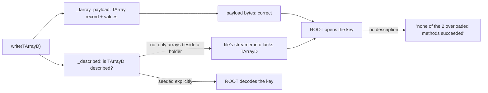

A standalone `TArrayI`/`TArrayD`/`TArrayF` key can be written byte-for-byte and ROOT will still refuse it, because ROOT reads a file's own streamer-info list before the objects: the key's bytes are right, the class is undescribed. ROOT says `TypeError: none of the 2 overloaded methods succeeded` from `TDirectoryFile::Get`, which reads like a broken object and is really a missing description.

## Where the two halves live

- **Bytes** — `writer.py`'s `_tarray_payload` writes the `TArray` record (a `TStreamerBase TArray` plus a counted `fArray`), reachable once `_record` resolves layouts through `layout_of` rather than `INFOS` (`INFOS` holds no `TArray` at all).
- **Description** — `_described` (`writer.py:940`) keeps arrays out of the closure unless a class holding one pulls them in, so a standalone array's class never reaches the file's streamer info.



## What to do

Seed the closure with the array's class when a standalone array is written, then check with the tool that only ROOT can answer:

```bash
PYTHONPATH=$PWD/src python -m tools.io_matrix --oracle-prefix ~/.local/root-oracle \
    --classes TArrayI,TArrayD,TArrayF
```

The honest reading of a failure like ROOT's above: suspect the *description* before the bytes, because the bytes were produced by the same code path that already writes arrays correctly inside a basket (`hits`, `run` in the tree round-trip).
