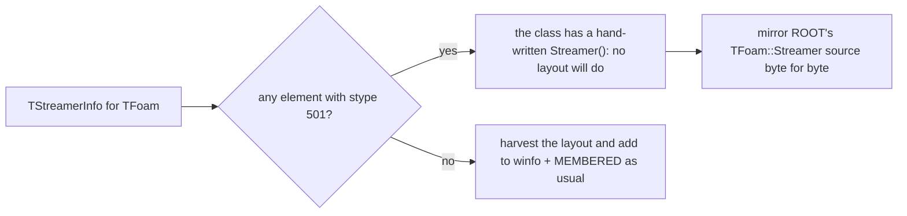

`TFoam` cannot be written by rewriting a harvested layout, because it has no declarative layout to harvest: ROOT writes a foam with its own hand-written `TFoam::Streamer()`. The harvested description shows it plainly — one member, `fCells` of type `TFoamCell**`, has streamer type **501** (`kStreamer`), which means "a member the class streams itself". `tools/harvest_infos.py`'s generator has no kind for 501 and fails with `KeyError: 501` before it can emit an `INFOS` block.

```bash
python -m tools.harvest_infos --root-prefix ~/.local/root-oracle foam_donor.root > /tmp/foam.json
python -c "
import json,collections;d=json.load(open('/tmp/foam.json'))['classes']['TFoam']
print(collections.Counter(e['stype'] for e in d['elements']))   # {... 501: 1}
print([(e['name'],e['type_name']) for e in d['elements'] if e['stype']==501])  # [('fCells','TFoamCell**')]"
python ~/.cache/xrdroot-runs/gen_infos.py /tmp/foam.json TFoam   # KeyError: 501
```



## What stype 501 means for the recipe

For an ordinary class the three-step recipe (donor → `harvest_infos` → `INFOS` + `writer.MEMBERED`) is enough. For a class with a `Streamer()` override it is not: the bytes are produced by C++ — `TFoam::Streamer` writes its integers and then loops over `fCells`, calling each cell's `Streamer()` — so the writer needs code that reproduces **that order**, not a member table.

Telling the two apart takes one command, and it belongs before a donor is trusted for a class you have not written before.

## The order the work has to take

1. `gDirectory`, so `TFoam::Write` has a file to write into (xrdroot has none);
2. a TFoam writer that mirrors `TFoam::Streamer`'s own field order, including `TFoamCell`'s streamer;
3. FOAM's cell grid, because `tools/tutorials/compare.py` compares ROOT files value by value.
