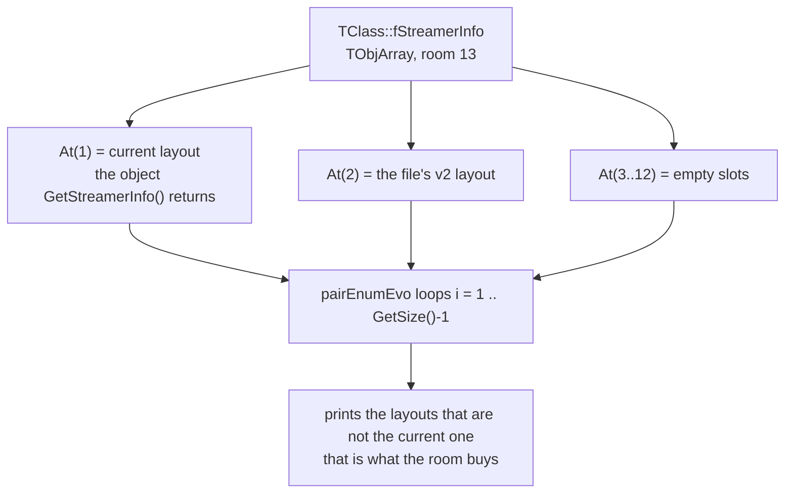

A roottest program that walks `TClass::GetStreamerInfos()` is written against an array whose `GetSize()` is its **room**, not its entries, and whose entries must be the very objects `GetStreamerInfo()` answers — implementing it as a freshly built, densely numbered list prints the wrong number of `#N StreamerInfo:` blocks and prints one for the class's own current layout as well.

Measured on the 6.40 oracle with `roottest/root/io/stdpair`'s own `aa02.root`/`ab02.root` and a `pair<reco::Muon::MuonTrackType, edm::Ref<...> >`: `GetStreamerInfos()->GetSize()` is **13** for `TNamed`, `TObject` and `pair<int,int>`, **15** for `TH1F`, and `GetLast()` is `-2` for a class with no layouts at all. The pair's array is `At(1) = v1 0xb5fb752` (the current one) and `At(2) = v2 0xb15d1241`, `size=13 last=2 entries=2`, and the same in either file order.

## What to do

Keep the array per class, `Expand` it to thirteen, and answer `GetStreamerInfo(version)` out of it. Then respect these five rules, each of which a currently green test pins (`tests/test_pyroot_reflection.py`):

| rule | the test that pins it |
|---|---|
| the room and the identity are **one** change; the room alone prints `#1` beside `#2` | `test_a_versioned_classs_layouts_are_indexed_by_version_and_a_hole_stays_empty` (its `GetSize() == 4` is wrong: the oracle says 13) |
| a class **in memory** lists its own layout first and each file's as met; only a class with no layout in memory is indexed by version | `test_files_layouts_are_numbered_as_met_while_no_class_is_in_memory` |
| the array's current entry keeps `from_file` when the current layout is the file's own, so it lists `offset=99999 type= 3 newtype=-1` | `test_a_layout_the_class_in_memory_disowns_is_listed_as_roots_file_layout` |
| building follows the **element**, not the layout: an enum element of an emulated class is built (`newtype=13`), a `TStreamerSTLstring` element (`type=300 stl=365 ctype=365 Emulation`) never is | `test_a_layout_a_file_holds_is_listed_beside_the_one_in_memory` (`"   i=" not in` its listing) |
| `FindStreamerInfo` keeps its **unbuilt** answer, and a version collision is not bumped | `test_a_pair_names_no_version_where_a_plain_class_names_the_files_own` |

An emulated class's *offsets* are a sixth, separate rule and are the other half of the same 40 refs: see `W0-230` in `TODO.md`.
