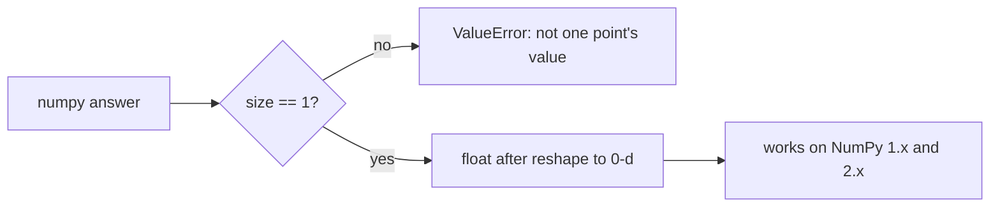

The local dev venv runs NumPy 1.26 while the CI runners run NumPy 2, so a `float()` of a one-element array passes here and fails there — check any new NumPy-to-Python scalar conversion against that rule before pushing, and treat `python -W error::DeprecationWarning` as the local stand-in for NumPy 2.

## What breaks and how to see it locally

Code written for arrays — the normal way to write a `TF1` here, since one call may take thousands of
rows at once — answers a **one-row** input with a one-element array. Extracting the number with
`float(answer)` was accepted with a warning until NumPy 2 made it an error:

```
TypeError: only 0-dimensional arrays can be converted to Python scalars
```

which is exactly what CI reported on Python 3.11/3.12/3.13 while 3.10 (NumPy 1.x) stayed green, from
round 118 to round 120 (`tests/test_pyroot_tkde.py::test_the_estimate_as_a_function_is_sampled_and_drawable`,
`src/xrdroot/pyroot/core/funcs.py`). Locally the same call only warns, so a green gate proves nothing
about it:

```bash
.venv/bin/python -W error::DeprecationWarning -c 'import numpy as np; float(np.array([2.5]))'
# DeprecationWarning: Conversion of an array with ndim > 0 to a scalar is deprecated,
# and will error in future. ... (Deprecated NumPy 1.25.)
```

## The rule

Take the element out explicitly: `float(np.asarray(answer, dtype=np.float64).reshape(()))` after
checking `size == 1`, and refuse several values rather than truncating to the first
(`funcs._scalar`). Do the same for `int()`, `bool()` and comparisons against a size-1 array.



## A function NumPy 2 removed outright

The conversion is a *deprecation* and shows up as a warning locally; a function NumPy 2 deleted
does not, because the local NumPy 1.26 still has it. `np.trapz` is the one that has bitten - in
the CI run of the tip that carried round 159 (`src/xrdroot/pyroot/mathfit.py`), five tests red on
every platform whose NumPy is 2:

```
AttributeError: module 'numpy' has no attribute 'trapz'. Did you mean: 'trace'?
```

NumPy 2 renamed it **`np.trapezoid`**. Thirty-odd names went the same way; the ones most likely
to appear in this repository are `trapz` -> `trapezoid`, `in1d` -> `isin`, `row_stack` -> `vstack`,
`msort` -> `sort(a, axis=0)`, `cumproduct` -> `cumprod`, `product` -> `prod`, `sometrue` -> `any`,
`alltrue` -> `all`, and the `np.NaN`/`np.Inf`/`np.float_` aliases (use `np.nan`/`np.inf`/
`np.float64`). The rest are in NumPy's own migration guide. A `grep -rn` for that list over `src`
and `tests` costs a second and is worth it before a push that touches numeric code.

The general rule: **the local venv cannot prove anything about names that exist in 1.26 and not
in 2**, only about warnings 1.26 emits. Anything new that leans on a NumPy function should be
looked up in NumPy 2's own API list rather than in the environment.
