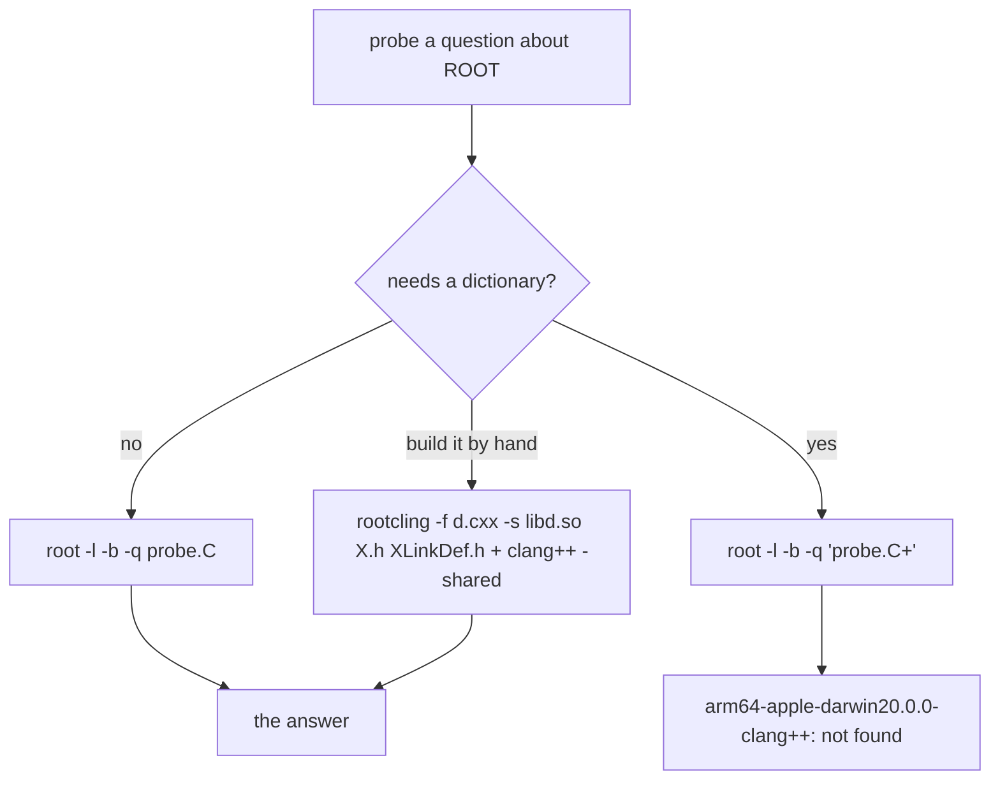

The 6.40 oracle on this machine cannot compile a macro: `root -l -b -q 'x.C+'` fails with `sh: arm64-apple-darwin20.0.0-clang++: command not found`, because the conda-forge ROOT was built for that triple and the local compiler is named differently. Probe with the **interpreter** instead.

## Probing the oracle

```bash
# works: the interpreter, no '+'
~/.local/root-oracle/bin/root -l -b -q probe.C

# fails on this machine
~/.local/root-oracle/bin/root -l -b -q 'probe.C+'
# sh: arm64-apple-darwin20.0.0-clang++: command not found
# Error in <ACLiC>: Executing '… arm64-apple-darwin20.0.0-clang++ …' failed!
```



Two things follow. A macro must be named after its own function (`void pairvec()`, not `void pairs()`), or ROOT warns *"Failed to call `pairvec()` to execute the macro"* and falls back to `.L`. And some questions cannot be asked this way at all: `TTree::Print`/`GetListOfLeaves` on a tree of `std::vector<std::pair<int,double>>` needs a dictionary for the branch element, which only ACLiC would build. So a layout question about a **container-inside-a-branch** is unanswerable here — record the question, not a guess.

## `GetSize()` is the room, `GetEntries()` the count

The same round's second finding, a design constraint rather than an oracle trick: ROOT's `TObjArray::GetSize()` answers **`fSize`, the array's capacity** (16 by default), while `GetEntries()` answers how many slots hold something. Two call sites in this kit need the room, and they are **one change**:

| site | why the room matters |
|---|---|
| `TCollection::Print`'s header | ROOT prints `size=16` for a fresh `TObjArray`; its entries are 0 |
| `TClass::GetStreamerInfos()` | round 112 measured it as a **thirteen**-slot array, and the version walk `for i in 1..GetSize()-1` only reaches `#2` because of it |

Changing `TObjArray.GetSize()` alone breaks the second: `GetSize() == 13` fails because the array is built with the default 16, and building it with `TObjArray(13)` then breaks `GetStreamerInfo(1)`'s slot. **The printer's room and the layouts array's room are one change**, and the reflection tests are what say so.
