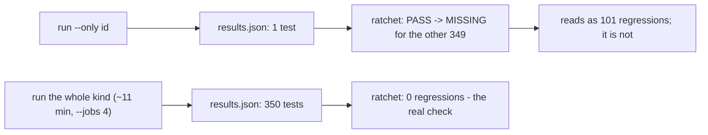

`tools/rootsuite ratchet` compares a results file to `tools/rootsuite/baseline.json` row by row, so a run made with `--only <id>` reports every *other* baseline PASS as `PASS -> MISSING: not in the results` and prints something like `101 regressions`. That is the harness working as designed, not a regression: the ratchet can only judge a run of the whole kind.

```bash
python -m tools.rootsuite run --kind gtest --jobs 1 --only 'gtest/tree/dataframe/dataframe_compgraph' \
    --root "$HOME/src/.xrdroot-scratch/rootsrc" --xrdroot-src "$WT/src" --out "$OUT"
# -> [1/1] PASS ... ; results.json holds one test
python -m tools.rootsuite ratchet "$OUT/results.json"
# -> 101 regressions   (the 349 other ids are MISSING, not failed)
```



## What to do instead

Banking one program's PASS needs two separate things, and they are not interchangeable:

- **the row's new status**, from a real run of that program — `--only <id>` is enough, and it is cheap (seconds);
- **proof that nothing else broke**, which only a whole-kind run gives. On this Mac the gtest kind takes about 11 minutes at `--jobs 4` (`~/.cache/xrdroot-runs/gtest-20261126-2346`: 350 programs, 671 s), and its ratchet then reads `0 regressions`.

So: bank the row when the single program passes, then confirm with the whole kind before believing the count. Never rewrite a baseline from a loaded run, and never quote a `--only` run's ratchet output as a regression figure.

## Where the baseline lives

`tools/rootsuite/baseline.json` covers **all five kinds** (2820 rows, 1619 PASS - see
`docs/architecture/the-baseline-covers-all-five-kinds-read-it-before-claiming.md`), so a
`--kind pyunittest` run is judged the same way and will also report the gtest rows MISSING.
Compare like with like: one kind's run against its own rows.

## Why it matters

A partial run's ratchet output looks exactly like a catastrophic regression, and it arrives right when you are trying to prove a change was safe. Reading it as one costs a debugging round; reading it as "fine, no regressions" hides the truth that the check was never performed.
