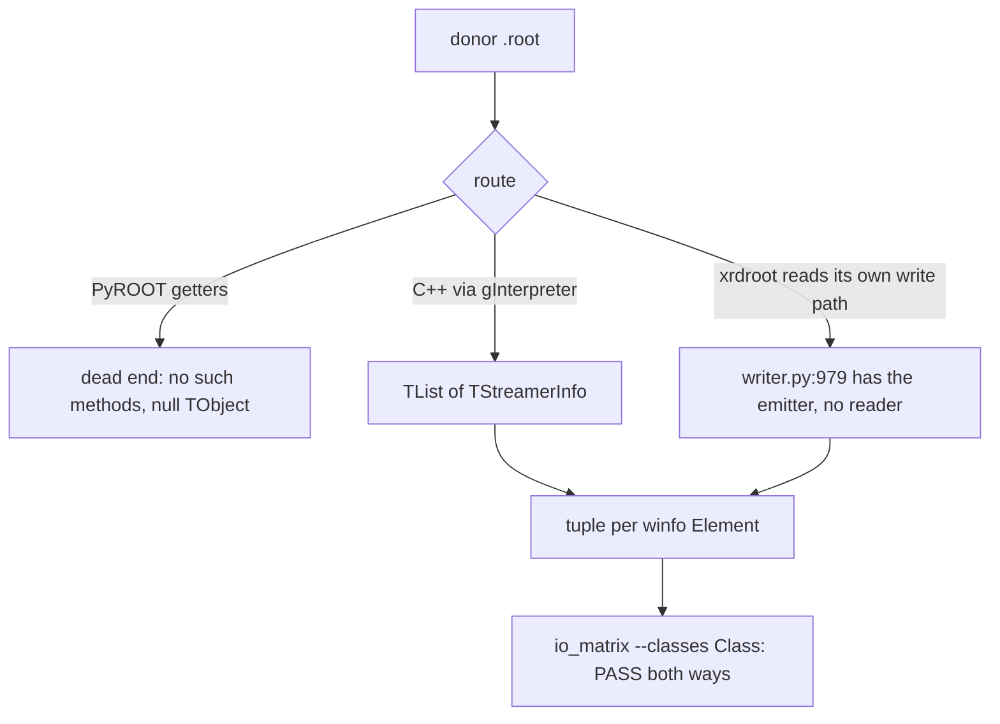

Reaching a ROOT file's `TStreamerInfo` list is harder than it looks, and both obvious routes are dead ends in this environment: PyROOT in the project's oracle exposes no way to fetch it, and xrdroot writes the record but has no reader for it. A layout harvester therefore starts by choosing a route that actually exists.

```python
# oracle (ROOT 6.40.04 PyROOT), donor file /tmp/mm.root holding a TMatrixD:
f.GetStreamerInfo()            # AttributeError: no such method
f.GetListOfStreamerInfo()      # AttributeError: no such method
ROOT.TStreamerInfo().BuildFromFile(path)   # AttributeError: no such method
f.Get("StreamerInfo")          # returns a null TObject, not the TList
```

## The route that works

`TFile::GetStreamerInfoList()`, called from a C++ block through `gInterpreter` — no PyROOT binding needed. It returns the file's `TList` of `TStreamerInfo`, each with its checksum, class version and elements:

```python
import ROOT
ROOT.gInterpreter.ProcessLine(r'''
{
  TFile *f = TFile::Open("/tmp/mm.root");
  TList *list = f->GetStreamerInfoList();
  TIter next(list);
  while (TStreamerInfo *si = (TStreamerInfo*)next())
    printf("%s checksum=%d version=%d elements=%d\n", si->GetName(),
           si->GetCheckSum(), si->GetClassVersion(), si->GetElements()->GetEntries());
}
''')
```

For a donor holding one `TMatrixD`:

```text
n=2
TMatrixT<double> checksum=135074716 version=4 elements=2
TMatrixTBase<double> checksum=-1961180639 version=5 elements=8
```

## The other route

**Teach xrdroot to read the record it already writes** — `src/xrdroot/writer.py:979` (`_streamers`) emits it, `writer.py:1024` (`_entry_into`) writes one class's entry, and the reader has no counterpart. That has independent value: a reader that used a file's own descriptions could decode classes it has no catalogue entry for.



## Why this matters

The failure mode of guessing is silent: `winfo` entries are emitted verbatim, so a wrong checksum or a misplaced max-index writes a file ROOT decodes as *different values*. The absence of a getter is not a reason to hand-type a layout; it is a reason to pick route 1 or 2.
