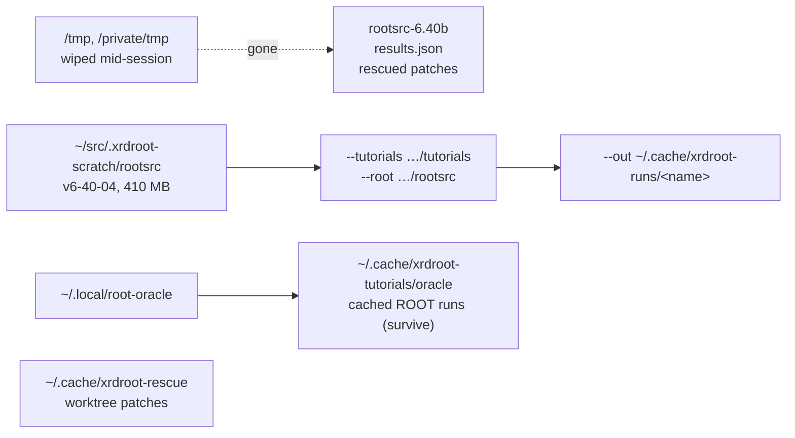

A long session that keeps ROOT's sources and its harness output under `/tmp` will lose both: `/tmp` is cleaned out while the session is running, and `/private/tmp` copies go with it. The tutorial harness then reports `0 tutorials` from a directory that existed an hour earlier (`catalog()` returns empty because `tutorials/CMakeLists.txt` is gone), and every `results.json` that a ledger row was going to quote is missing.

## Where the pieces are



- ROOT 6.40.04's sources, already sparse: **`/Users/rcurrie/src/.xrdroot-scratch/rootsrc`** (410 MB, with `tutorials/`, `test/`, `roottest/`, `cmake/modules`; `git describe` says `v6-40-04`). Pass `--tutorials /Users/rcurrie/src/.xrdroot-scratch/rootsrc/tutorials` and `--root /Users/rcurrie/src/.xrdroot-scratch/rootsrc`.
- The oracle (`~/.local/root-oracle`) and its cache (`~/.cache/xrdroot-tutorials/oracle`) are already durable — the cached ROOT runs are the expensive part and they survive a clean.
- New harness output: **`--out /Users/rcurrie/.cache/xrdroot-runs/<name>`**, one directory per run, kept and quoted from `TODO.md`/`.ralph/ROOT.md` by that path.
- Rescued patches from a worktree cleanup: `~/.cache/xrdroot-rescue/`, never `/tmp`.

## After a wipe: prune, rebuild, then prove it

`git worktree list` keeps listing every worktree whose directory is gone, so the first symptom is confusing: paths that exist in git and not on disk. Drop the registrations first, then rebuild:

```bash
git -C <repo> worktree prune
```

A rebuilt source tree is only worth using if the suite finds the same tests it found before. This one line settles it:

```bash
PYTHONPATH=$PWD/src python -m tools.rootsuite list --root ~/src/.xrdroot-scratch/rootsrc
```

Expect `total 3714` and `in scope (not tutorials): 2820`. A truncated or depth-mangled clone reports **zero roottest tests**, which reads like a code failure and is not one.

Untracked files in a checkout go the same way, to `git clean -xdff` in whatever worktree is rebuilding: a gotcha written straight into `docs/` vanished that way twice in one session. Push work that matters as a branch (`archive/<name>`) or a commit rather than leaving it on disk.

## Why it matters

Two pieces of work were lost this way: 24 rescued worktree patches, and a whole tutorial sweep's `results.json`. Re-cloning ROOT's sparse tree costs ten minutes; losing the run costs an hour of oracle time.
