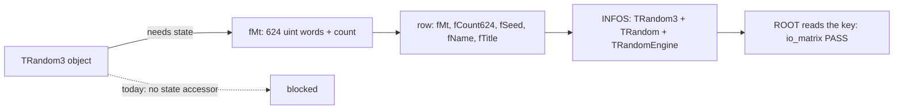

`TRandom3` looks like one class to add and is four: `TRandom3` (checksum 2185949371, v2), its base `TRandom` (235880363, v3), which itself has the bases `TNamed` and `ROOT::Math::TRandomEngine` (3688732995, v1). Only `TNamed` is already in `winfo.INFOS`. Worse, a correct record needs the engine's **624-element Mersenne state** (`fMt`, `unsigned int[624]`, plus `fCount624`), which xrdroot's `TRandom3` object does not expose — so adding the layout alone would write a file that reads back a *different stream*.

```bash
~/.local/root-oracle/bin/python -c "
import ROOT
f = ROOT.TFile.Open('/tmp/tr.root', 'RECREATE')
r = ROOT.TRandom3(7); r.Rndm(); r.Write('r'); f.Close()"
python -m tools.harvest_infos --out harvest-tr.json /tmp/tr.root
```

```text
TRandom3                  2185949371  v2  TRandom BASE, fMt uint[624], fCount624 int
TRandom                   235880363   v3  TNamed BASE, ROOT::Math::TRandomEngine BASE, fSeed uint
TNamed                    3753331260  v1  TObject BASE, fName TString, fTitle TString   (in INFOS)
ROOT::Math::TRandomEngine 3688732995  v1  (no members)
```

## The prerequisite, in order

1. Give xrdroot's `TRandom3` a way to hand out its state — the 624 words and the count — as ROOT streams them. Without it there is no row to build.
2. Then three `INFOS` entries, with `fMt` as a counted array element (streamer type 33, `kOffsetL + kUInt`, array length 624) and the two `TStreamerBase` elements carrying each base's checksum in max-index slot 1.
3. Accept with `python -m tools.io_matrix --oracle-prefix ~/.local/root-oracle --classes TRandom3` reading PASS in both columns.



A general note for the batch ahead: some classes are like `TMatrixD` — layout plus a row from public accessors — and some are like `TRandom3`, where the *object* must first expose the state the file holds. Check which kind it is before writing an entry.
