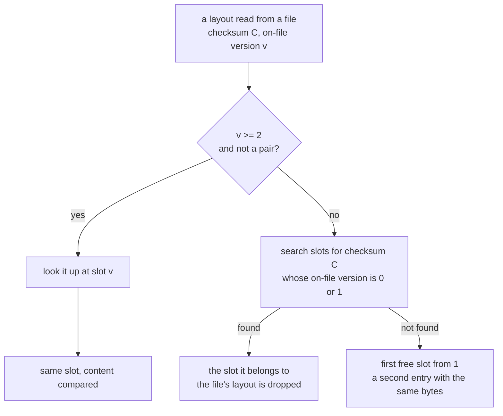

A layout read from a file is not deduplicated against the layouts a class already holds by checksum alone: `TStreamerInfo::BuildCheck` matches by checksum **only** against an entry whose `GetOnFileClassVersion()` is 0 or 1, and by class version otherwise, so two files that record the same bytes under different version numbers leave the class holding both and `GetStreamerInfos()` prints the layout twice.

Measured on the 6.40 oracle with `roottest/root/io/stdpair`'s own two input files and a `pair<reco::Muon::MuonTrackType, edm::Ref<...> >`: `ab02.root` holds the pair at version 1 (checksum `0xb15d1241`, `first type= 3`) **and** at version 2 (checksum `0xb5fb752`, `first type=13`), while `aa02.root` holds the `0xb5fb752` layout as version 1. Read `ab02.root` then `aa02.root` the array is `At(1) = 0xb15d1241`, `At(2) = 0xb5fb752`, `At(3) = 0xb5fb752` — the version-1 record of `aa02.root` is held beside the version-2 record it repeats, because the held one is versioned; `pairEnumEvo` prints them as its `#2` and `#3` blocks, which its own source calls "after update it now has duplicated StreamerInfo". Read in the other order the version-2 record is found at `At(1)` by checksum and dropped, leaving two entries.

## What to do

Keep the version each layout **recorded** beside the slot it ended up at. Re-numbering a layout that lands above one already taken is a separate rule (an emulated class numbers its layouts as they come), so the slot is not the recorded version and a checksum match must not be decided on the slot. In this kit that is `RECORDED` in `src/xrdroot/pyroot/core/reflection.py`, filled where the layout is noted and read by `_same_layout`.

`tests/test_pyroot_reflection.py::test_a_layout_a_file_numbers_is_held_beside_the_layout_it_repeats_unversioned` pins the three-slot case, and `::test_files_layouts_are_numbered_as_met_while_no_class_is_in_memory` pins the other side of it: a file opened twice is one layout, because the second read matches the checksum of an entry recorded unversioned and is dropped.

What is left of `io/stdpair` is not this rule: see `W0-243`/`W0-245` in `TODO.md` — ROOT's in-memory layout of a **synthetic pair** is the emulated one (`first type=13`, title `Emulation`), so the file's mapped layout of the same version takes a slot *beside* it instead of becoming the current one.
