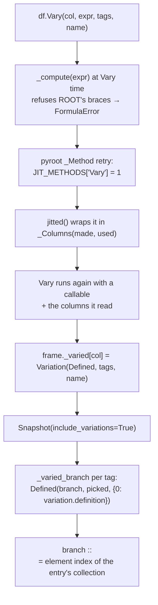

`RDataFrame.Vary` and a `Snapshot` that writes the variations now exist: `Vary("scale", "ROOT::VecOps::RVec<...>({a, b})", ["down", "up"], "unc")` keeps the column's own value as the nominal, and `Snapshot` with `fIncludeVariations` writes `scale:unc:down` and `scale:unc:up` beside it. `pyunittest/tree/dataframe/dataframe_snapshot_py` PASSES at `401544c3`.



## Where the pieces are

- `Variation` and `_with_variations` / `_varied_branch` in `src/xrdroot/rdf/frame.py`; `_varied` is a per-frame dict copied by `_derived`.
- `include_variations` is `Snapshot`'s keyword in the engine; `pyroot/rdf/snapshot.py::keywords_of` maps `RSnapshotOptions.fIncludeVariations` onto it.
- `pyroot/rdf/jitted.py`: `JIT_METHODS["Vary"] = 1` and the `_Columns` wrapper, so a translated callable carries `used` for `Vary` to name.

## Traps

- **A `Vary` expression is a C++ string and must compile where it is given.** Compiling it lazily inside `Snapshot` means the pyroot retry never sees the failure, and ROOT's own expression (`ROOT::VecOps::RVec<ROOT::VecOps::RVec<float>>({...})`) is refused by the batch evaluator: braces are not its syntax. Compile in `Vary`, so the retry fires.
- **`_applied` in `jitted.py` rewrites the argument list per method.** Its fallback returns `[*given[:at], made, used]`, which for `Vary` would *replace the tags with the column list* — the branch names came out `scale:pt`. `Vary` needs `[*given[:at], _Columns(made, used), *given[at + 1:]]`: everything after the expression stays.
- **A branch name may not be a valid C++ identifier.** `_check_new` refuses `scale:unc:down`, so the branch is built with `Defined(...)` and `_derived(columns=...)` directly, not through `Define`. Reading such a column back works through `_column`'s name lookup, but not as a *formula* (a `:` there is a ternary).
- **`float` values must be compared as `float`**: a written `RVec<float>` comes back with float32 precision, so `assert ... == [[1.005, 1.005]]` fails at the 8th digit.

## How to check

```bash
python -m tools.rootsuite run --root ~/src/.xrdroot-scratch/rootsrc -j 2 \
  --xrdroot-src <worktree>/src --out ~/.cache/xrdroot-runs/goal-vary \
  --only 'pyunittest/tree/dataframe/dataframe_snapshot_py'
```

`tests/test_rdf_vary.py` covers the branch names and values, the unnamed `scale:down` spelling, `nVariations`, a column with no variation in the same Snapshot, and the two refusals. `tests/test_pyroot_distrdf_rdf.py::test_snapshot_options_say_what_xrdroots_snapshot_is_told` pins the keyword dict, which now carries `include_variations`.
