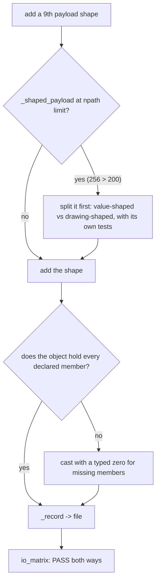

A record must write **every** member its layout declares, including ones the object does not hold — `TLatex`'s engine has no `fLimitFactorSize`, and passing `None` into the packer raises `struct.error: required argument is not an integer`. And a ninth payload shape no longer fits the dispatch: `_shaped_payload` sits at the maintainability limit, so it has to be split *before* the class is added, not after.

```text
$ python tools/maintainability.py check
  src/xrdroot/writer.py::_shaped_payload: npath=256 > limit 200
```

## The two rules

1. **Fill missing members with a typed zero** while casting:
   ```python
   held = row.get(name)
   row[name] = int(held or 0) if integer else float(held or 0.0)
   ```
   with `integer = FORMS[stype] in "bBhHiIlLqQ"`. This is what made `TLatex` cross ROOT both ways (`io_matrix --classes TLatex` → 1 of 1).
2. **Members are flat**: a base's members (`fTextColor`, `fLineColor`, …) sit beside the class's own in the engine's dict, so the cast walks the whole description closure (`_closure({classname: None})`), not just the class's own elements.



## Why the order matters

Splitting `_shaped_payload` *while* adding the class produced 13 failing tests in this round, and the class had to be reverted with the split. Split first, run `pytest tests/test_writer_tarray.py`, and only then add the payload — otherwise a working class is thrown away with a broken refactor.

`TObjArray` is not this problem at all: `unwrap(ROOT.TObjArray())` has **no `members`**, so it needs a collection payload — a count, then each child through `_record`.
