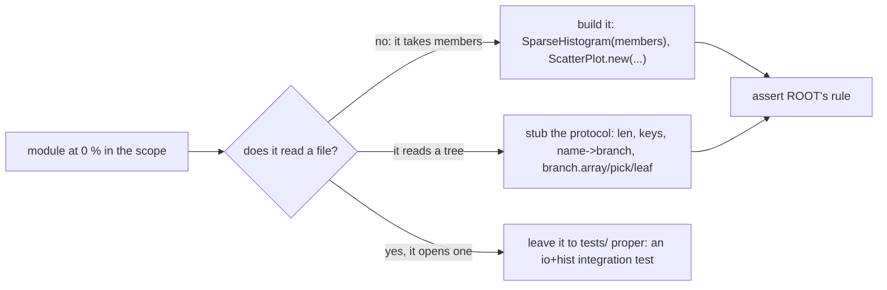

A `hist`-component test may not open a ROOT file (that drags `io` in and the isolation check refuses it), but most of the component's uncovered modules can still be tested in place: the object is **made in code**, or the thing it reads is a **small protocol** a test can answer with a table. That is the line to look for first when a module shows 0 % coverage in a component's own scope.



## The two shapes that carry almost everything

**Made in code.** `THnSparse` is streamed as plain dictionaries, so `SparseHistogram({"TNamed": …, "fChunks": […]})` needs no file. `TScatter` books its own frame: `ScatterPlot.new("sp", x, y, colors=…, sizes=…)` then `frame()`, `colour_fractions()`, `marker_sizes()`.

**A protocol, stubbed.** `formula/select.py` asks a *source* for `len()`, `keys()`, `name → branch`, and each branch for `array(low, high)`, `pick(rows)`, `leaf.title`, `is_jagged`, `length`, `typename`. A twenty-line `Source`/`Branch` pair over NumPy arrays exercises the whole module. The stub is a test double for a protocol, not a fake behaviour: every assertion is about what the engine does.

## What does not work

A test that opens a fixture with `open_root` cannot enter the scope. A private import of another component is refused unless declared, so a test of *that* module belongs where that module is owned.

## Verifying a slice

```bash
python tools/components.py isolate hist --tests hist      # the scope runs, exit 0
python -m pytest <file> --cov=xrdroot --cov-report=term-missing | grep <module>
```

A module absent from `term-missing` is at 100 % (coverage's `skip_covered`). Measure the scope's unexercised total by filtering `coverage report` to the component's `ownership.<name>.modules`, not to the whole package.
